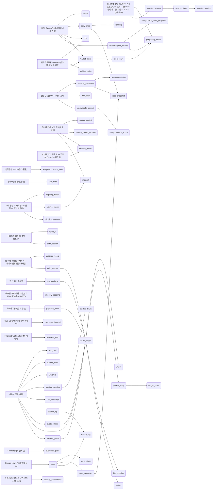

# 데이터 계보(lineage)

`python run.py data-docs` 로 생성. 원천(사각) → 표(둥근) → 쓰임.

| 상류 | 하류 | 거치는 코드 |
|---|---|---|
| KRX OpenAPI(국내 일별 시세·지수) | stock | collectors.krx · services.catalog |
| KRX OpenAPI(국내 일별 시세·지수) | daily_price | collectors.marketgen.seed_market |
| KRX OpenAPI(국내 일별 시세·지수) | ohlc | collectors.marketgen |
| 한국투자증권 Open API(실시간·당일 봉·금리) | ohlc | collectors.realtime.refresh_latest_bars(당일 봉) |
| 한국투자증권 Open API(실시간·당일 봉·금리) | realtime_price | collectors.realtime(웹소켓) |
| KRX OpenAPI(국내 일별 시세·지수) | market_index | collectors.indexes |
| 한국투자증권 Open API(실시간·당일 봉·금리) | market_index | collectors.indexes |
| market_index | index_daily | collectors.indexes |
| 금융감독원 DART(재무·공시) | financial_statement | collectors.dart |
| 금융감독원 DART(재무·공시) | dart_corp | collectors.dart |
| Google News RSS(종목 뉴스) | news | collectors.news |
| news | news_stock | collectors.news(종목 태그) |
| news | news_sentiment | services.themes.classify_news(사전·KR-FinBert) |
| daily_price | ranking | services.market |
| financial_statement | recommendation | run._build_similar |
| daily_price | reco_snapshot | services.reco_engine(멀티팩터) |
| financial_statement | reco_snapshot | services.reco_engine |
| news_sentiment | reco_snapshot | services.reco_engine |
| FinanceDataReader(야후·네이버) | overseas_ohlc | collectors.overseas_market |
| SEC EDGAR(해외 재무·주식수) | overseas_financial | collectors.edgar |
| Finnhub(해외 실시간) | overseas_quote | collectors.overseas_realtime |
| 한국수출입은행(환율) | app_meta | collectors.forex(환율 캐시) |
| 한국은행 ECOS(금리·환율) | analytics.indicator_daily | collectors.ecos |
| KRX OpenAPI(국내 일별 시세·지수) | analytics.price_history | collectors.krx_history |
| analytics.price_history | analytics.mv_stock_snapshot | V003/V007 머티리얼라이즈드 뷰 |
| 금융감독원 DART(재무·공시) | analytics.fin_annual | collectors.dart_platform |
| analytics.fin_annual | analytics.credit_score | models.credit_risk(정보계) |
| 사용자 입력(화면) | app_user | services.auth |
| 사용자 입력(화면) | survey_result | services.survey |
| 사용자 입력(화면) | watchlist | services.watchlist |
| 사용자 입력(화면) | practice_session | services.practice |
| practice_session | practice_trade | services.practice.trade |
| 사용자 입력(화면) | chat_message | services.chat(봉투 암호화) |
| 웹 화면 계산값(브라우저 — 서버가 범위 검증·재채점) | practice_record | services.practice_records(브라우저 계산값 — 범위 검증) |
| 웹 화면 계산값(브라우저 — 서버가 범위 검증·재채점) | quiz_attempt | services.quiz(서버 재채점) |
| quiz_attempt | wallet_ledger | services.quiz(정답 보상 — 같은 트랜잭션, 하루 1번) |
| 사용자 입력(화면) | avatar_closet | services.avatar(구매·착용 — 가격은 서버 카탈로그) |
| avatar_closet | wallet_ledger | services.avatar.buy(차감과 같은 트랜잭션) |
| 앱 스토어 영수증 | iap_purchase | services.iap |
| 토스페이먼츠(결제 승인) | payment_order | services.toss |
| iap_purchase | wallet_ledger | services.wallet.apply |
| payment_order | wallet_ledger | services.wallet.apply |
| 사용자 입력(화면) | wallet_ledger | services.transfer · attendance · invest |
| wallet_ledger | wallet | services.wallet(잔액) |
| wallet_ledger | journal_entry | services.ledger.post(복식부기) |
| journal_entry | ledger_close | services.ledger.close_pending(놓친 날까지 차례로) |
| wallet_ledger | fds_decision | services.fds.screen·record(송금 트랜잭션 안) |
| wallet_ledger | outbox | services.transfer(아웃박스) |
| 서버 운영 지표(요청·DB 연결 — 워커 메모리) | capacity_report | services.capacity.report(부하 단계 경계·심각 진입) |
| 관리자 조치·보안 규칙(자동 대응) | service_control | services.controls(즉시 중지 · 자동 차단 규칙) |
| 관리자 조치·보안 규칙(자동 대응) | service_control_request | services.controls(재개 요청 → 다른 관리자 승인) |
| 브라우저 기기 키 증명(DPoP) | dpop_jti | security.dpop.consume(1회용 증명) |
| 브라우저 기기 키 증명(DPoP) | auth_session | security.sessions.create(기기 키 지문) |
| 수준진단 카탈로그·근거(코드·시험·문서) | security_assessment | security.assessment.run(근거 확인 + 운영 점검 — 다이제스트는 감사 체인에) |
| 배포된 코드·화면 파일(설치본 — 파일별 SHA-256) | integrity_baseline | security.integrity.record_baseline(배포 직후 · 소유자 계정) |
| 설치본(자기 해제 셸 — 압축본 SHA-256 머리말) | change_record | services.changes.request·gate(설치본 해시·사전 영향 분석·자동 점검) |
| 관리자 조치·보안 규칙(자동 대응) | change_record | services.changes.decide·review(요청자 ≠ 승인자) |
| 서버 운영 지표(요청·DB 연결 — 워커 메모리) | uptime_check | services.incidents.run_check(1분 합성 모니터링) |
| uptime_check | incident | services.incidents.evaluate(10분 실패·지연 → 장애 판정) |
| 관리자 조치·보안 규칙(자동 대응) | incident | services.incidents.open_manual·update(원인·조치·보고 단계) |
| news | archive_log | services.ilm.archive(보관 기한 지난 달 → gzip JSON Lines·SHA-256 → 정리) |
| search_log | archive_log | services.ilm.archive(같은 규칙) |
| 서버 운영 지표(요청·DB 연결 — 워커 메모리) | db_size_snapshot | services.dbhealth.snapshot(매일 크기·추세) |
| analytics.price_history | yangbong_basket | services.yangbong.run(팀 알고리즘 yangbong_picks — 끝난 주 선정·30일 채점) |
| index_daily | yangbong_basket | services.yangbong.run(같은 기간 코스피 시가→종가) |
| 팀 저장소 산출물(양봉이 백테스트 247주 CSV · 가상 주가 생성기 시즌 파일 — 코드와 함께 배포) | yangbong_basket | services.yangbong.seed(팀 백테스트 247주 CSV) |
| 팀 저장소 산출물(양봉이 백테스트 247주 CSV · 가상 주가 생성기 시즌 파일 — 코드와 함께 배포) | vmarket_season | services.vmarket.import_season(형식·가격 검사·SHA-256 — 시작한 시즌은 변경 거부) |
| 사용자 입력(화면) | vmarket_entry | services.vmarket.join(참가금 — 지갑 출금과 같은 트랜잭션) |
| vmarket_entry | wallet_ledger | services.vmarket.join·settle(참가금 출금·정산 입금, 멱등키) |
| vmarket_season | vmarket_trade | services.vmarket.order(체결가 = 서버 시계의 공개된 마지막 봉 종가) |
| vmarket_trade | vmarket_position | services.vmarket.order·settle(같은 트랜잭션) |

## 쓰임

| 표 | 화면·모형 |
|---|---|
| analytics.credit_score | 정보계 CLI |
| archive_log | 관리 /admin/db(수명주기)·복원(run.py ilm-restore)·월간 재해시(ilm-verify) |
| avatar_closet | 양봉이 꾸미기·마이페이지 프로필·홈 로그인 카드 |
| capacity_report | 관리 /admin/capacity·운영 알림(성능관리보고서) |
| change_record | 배포 게이트(vm.sh)·관리 /admin/changes·사고보고서 '변경시점' |
| daily_price | 국내 종목 화면·추천·위험(VaR) |
| db_size_snapshot | 관리 /admin/db(증가 추세·디스크 소진 예측)·DB 진단 경보 |
| dpop_jti | PEP·토큰 갱신(재사용 거부) |
| fds_decision | FDS 검토(관리자) |
| financial_statement | 재무 건전성·PER/PBR |
| incident | 관리 /admin/incidents(보고 기한·초안)·수준진단 점검 |
| integrity_baseline | 무결성 검사(10분)·/admin/integrity |
| journal_entry | 일 마감·시산표(관리자) |
| market_index | 홈 지수 |
| news | 뉴스 화면 |
| news_sentiment | AI 뉴스 픽 |
| ohlc | 종목 차트·실습 |
| overseas_ohlc | 해외 종목 화면 |
| practice_record | 실습 목록 '나의 실습 기록'·마이페이지 실습 이력 |
| quiz_attempt | 용어사전 퀴즈·마이페이지 퀴즈 완료 |
| realtime_price | 실시간 시세 표시 |
| reco_snapshot | 오늘의 추천·사후 검증 |
| security_assessment | 관리 /admin/assessment(이력·퇴보 경보)·경영진 보고 |
| service_control | PEP(돈 동작 집행)·관리 /admin/controls |
| uptime_check | 가용률(/admin/incidents)·장애 판정 |
| vmarket_entry | 모의투자 화면 참가·수익률·시즌 기록(/vmarket/me)·마이페이지 지갑 내역 |
| vmarket_season | 모의투자 화면 차트(/vmarket/season — 공개된 봉까지만) |
| wallet | 마이페이지 지갑 |
| yangbong_basket | 홈 '이번 주 양봉이가 고른 5종목'·'한 달 전 양봉이 바구니 결과'(/yangbong/weekly) |
