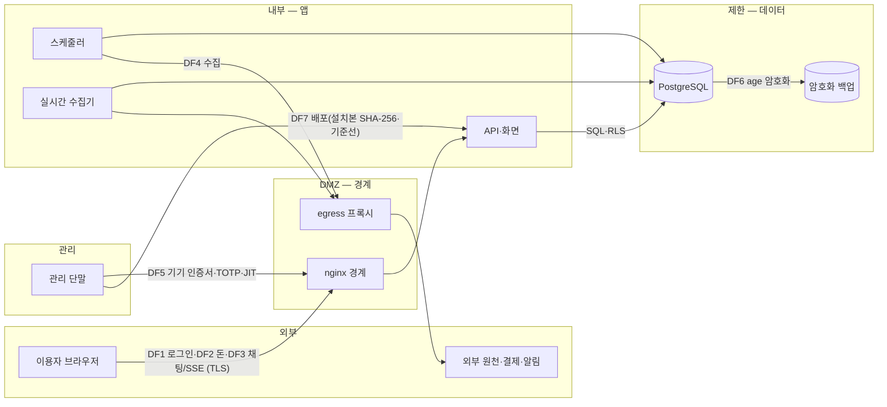

# 자산·위험 등록부 — OUTOFSTOCK

> 생성: `python run.py assurance-docs` · 원천: 자산은 코드(분류 등록부·접근 정책·허용 목록·잠금 파일·배포 구성), 위협은 [`threat_model.md`](threat_model.md) §3, 점수·처리는 `app/security/risk_register.json`.
> 자율보안 수행 4단계 — **자산 식별·중요도 평가 → 위협 시나리오 정의 → 리스크 측정 → 리스크 해결 및 검증**을 한 문서로.

## 1. 자산 식별·중요도

중요도(데이터·구성요소) = 기밀성 + 무결성 + 가용성(각 1~3) → 8~9 **1등급(핵심)** · 6~7 2등급(중요) · 3~5 3등급(일반). 업무 서비스는 접근 정책의 중요도(critical → 1등급), 외부 연동은 등록부의 중요도(높음 → 1등급).

| 자산 | 개수 | 1등급 | 2등급 | 3등급 |
|---|---:|---:|---:|---:|
| 데이터(표) | 74 | 26 | 22 | 26 |
| 업무 서비스(정책 동작) | 29 | 21 | 5 | 3 |
| 외부 연동(호스트) | 25 | 1 | 6 | 18 |
| 구성요소 | 8 | 4 | 3 | 1 |
| 소프트웨어(해시 고정 패키지) | 52 | — | — | — |

### 구성요소와 신뢰 구역

| 구성요소 | 구역 | 기밀성·무결성·가용성 | 중요도 |
|---|---|---|---|
| nginx 경계(TLS·요청률·본문 상한·관리 경로 mTLS) | DMZ | 2·3·3 | 1등급(핵심) |
| egress 프록시(squid — 허용 목록·내부 주소 거부) | DMZ | 1·3·2 | 2등급(중요) |
| API·웹 화면(FastAPI/uvicorn — PEP·PDP·세션) | 내부 | 3·3·3 | 1등급(핵심) |
| 배치 스케줄러(적재·원장 마감·보안 일일 작업) | 내부 | 2·3·2 | 2등급(중요) |
| 실시간 시세 수집기(KIS·Finnhub 웹소켓) | 내부 | 1·2·2 | 3등급(일반) |
| PostgreSQL 16(FORCE RLS·복식부기·감사 체인) | 제한 | 3·3·3 | 1등급(핵심) |
| 백업(age 암호화·원격 사본·WAL) | 제한 | 3·3·2 | 1등급(핵심) |
| 관리 단말(SSH 키·관리자 대역·기기 인증서·TOTP) | 관리 | 3·3·1 | 2등급(중요) |

### 데이터 자산(분류 등록부의 모든 표)

| 표 | 분류 | 기·무·가 | 중요도 | 보호 | 설명 |
|---|---|---|---|---|---|
| `app_user` | L3 | 3·3·3 | 1등급(핵심) | — | 회원 계정(아이디·상태·잠금) |
| `auth_refresh_used` | L4 | 3·3·3 | 1등급(핵심) | hash | 사용한 갱신 토큰 해시(재사용 탐지) |
| `auth_session` | L3 | 3·3·3 | 1등급(핵심) | — | 로그인 세션(기기 계열·IP 대역·만료·위험 신호·기기 결속 키 지문) |
| `auth_token` | L4 | 3·3·3 | 1등급(핵심) | hash | 접근 토큰(10분) — 해시만 |
| `iap_purchase` | L3 | 3·3·3 | 1등급(핵심) | rls | 인앱 충전 기록(영수증은 해시) |
| `payment_order` | L3 | 3·3·3 | 1등급(핵심) | rls | 토스 결제 주문 |
| `user_mfa` | L4 | 3·3·3 | 1등급(핵심) | encrypt, hash | 2단계 인증 비밀키(암호화)·복구 코드(해시) |
| `wallet` | L3 | 3·3·3 | 1등급(핵심) | rls | 가상머니 지갑 잔액(낙관적 잠금 version) |
| `wallet_ledger` | L3 | 3·3·3 | 1등급(핵심) | rls | 지갑 원장(모든 입출금 — 잔액 대사 근거) |
| `attendance` | L3 | 3·3·2 | 1등급(핵심) | rls | 출석 기록·보상 |
| `audit_log` | L3 | 3·3·2 | 1등급(핵심) | append_only, pseudonym | 감사 로그(해시 체인 — 누가·언제·무엇을) |
| `avatar_closet` | L3 | 3·3·2 | 1등급(핵심) | rls | 양봉이 꾸미기 — 산 아이템·산 가격·착용 상태 |
| `dpop_jti` | L2 | 2·3·3 | 1등급(핵심) | — | 기기 결속 증명 재사용 방지(키 지문·증명 ID — 아이디 없음) |
| `fds_decision` | L3 | 3·3·2 | 1등급(핵심) | — | 이상거래탐지 판정(점수·규칙·재료) — 관리자 검토용 |
| `invest_position` | L3 | 3·3·2 | 1등급(핵심) | rls | 장기 모의투자 보유·실현손익 |
| `journal_entry` | L2 | 2·3·3 | 1등급(핵심) | append_only, pseudonym | 복식부기 분개(계좌번호·시스템 계정 — 아이디 없음, 추가만) |
| `pii_access_log` | L3 | 3·3·2 | 1등급(핵심) | append_only | 관리자 개인정보 열람 기록(목적 포함) |
| `rate_event` | L2 | 2·3·3 | 1등급(핵심) | pseudonym | 시도 제한 기록(키는 해시 — 아이디·IP 원문 아님) |
| `role_activation` | L2 | 2·3·3 | 1등급(핵심) | — | 관리 권한 JIT 활성 기록(사유·시간) |
| `role_request` | L2 | 2·3·3 | 1등급(핵심) | — | 역할 부여 요청·승인(2인) |
| `security_event` | L3 | 3·3·2 | 1등급(핵심) | pseudonym | 보안 이벤트·자동 대응 결과 |
| `service_control` | L2 | 2·3·3 | 1등급(핵심) | — | 서비스 비상 차단 상태(기능별 운영/중지·사유·변경자) |
| `user_role` | L2 | 2·3·3 | 1등급(핵심) | — | 관리 역할 자격(2인 승인·만료) |
| `vmarket_entry` | L3 | 3·3·2 | 1등급(핵심) | rls | 모의투자 시즌 참가(참가금·시즌 현금·정산 금액) |
| `vmarket_position` | L3 | 3·3·2 | 1등급(핵심) | rls | 모의투자 시즌 종목별 보유(수량·평균단가·실현손익) |
| `vmarket_trade` | L3 | 3·3·2 | 1등급(핵심) | rls | 모의투자 시즌 체결(매수·매도·정산 자동 매도) |
| `access_log` | L3 | 3·2·2 | 2등급(중요) | rls | 접속 기록(로그인·로그아웃·기기 계열) |
| `archive_log` | L2 | 2·3·2 | 2등급(중요) | append_only | 데이터 수명주기 보관 기록(기간·파일·SHA-256·행 수·정리·복원 시각 — 개인정보 없음, 앱은 삭제·해시 수정 불가) |
| `change_record` | L2 | 2·3·2 | 2등급(중요) | — | 변경 기록(요청·사전 영향 분석·자동 점검·승인·적용·사후 검토 — 개인정보 없음, 앱은 삭제·해시 수정 불가) |
| `chat_message` | L3 | 3·2·2 | 2등급(중요) | rls | 1:1 채팅 |
| `friend_request` | L3 | 3·2·2 | 2등급(중요) | rls | 친구 요청 |
| `friendship` | L3 | 3·2·2 | 2등급(중요) | rls | 친구 관계(양방향 두 행) |
| `incident` | L2 | 2·3·2 | 2등급(중요) | — | 장애·사고 사건(지속 시간·영향 이용자 수·보고 대상·기한·단계·원인·대책 — 개인정보 없음, 앱은 삭제 불가) |
| `integrity_baseline` | L2 | 2·3·2 | 2등급(중요) | append_only | 파일 무결성 기준선(배포 파일별 SHA-256 — 소유자 계정만 기록, 앱은 읽기만) |
| `learning_log` | L3 | 3·2·2 | 2등급(중요) | rls | 학습 열람·진도 기록 |
| `ledger_close` | L2 | 2·3·2 | 2등급(중요) | append_only | 일 마감 결과(합계·대사·해시 사슬, 추가만) |
| `outbox` | L2 | 2·3·2 | 2등급(중요) | pseudonym | 트랜잭셔널 아웃박스(전달 대기 사건 — 가명·금액만) |
| `practice_record` | L3 | 3·2·2 | 2등급(중요) | rls | 웹 실습 기록(기법·방식·수익률 — 브라우저 계산값, 보상과 무관한 표시용) |
| `practice_session` | L3 | 3·2·2 | 2등급(중요) | rls | 과거 사례 실습 진행 상태(계정 또는 게스트 쿠키 ID) |
| `practice_trade` | L3 | 3·2·2 | 2등급(중요) | rls | 실습 체결 기록(소속 실습의 주인 기준 RLS) |
| `quiz_attempt` | L3 | 3·2·2 | 2등급(중요) | rls | Daily Stock Quiz 결과(날짜·고른 답·서버 채점 점수 — 하루 1행) |
| `security_assessment` | L2 | 2·3·2 | 2등급(중요) | append_only | 금융보안 수준진단 결과(항목별 등급·근거 종류·운영 점검 — 개인정보 없음, 추가만) |
| `service_control_request` | L2 | 2·3·2 | 2등급(중요) | — | 서비스 재개 요청·승인(2인) |
| `survey_result` | L3 | 3·2·2 | 2등급(중요) | rls | 투자 성향 분석 결과(이력) |
| `watchlist` | L3 | 3·2·2 | 2등급(중요) | rls | 관심종목 |
| `app_meta` | L2 | 2·2·2 | 2등급(중요) | — | 키-값 운영 메타(출처·기준일·배치 상태·암호화된 외부 토큰) |
| `db_size_snapshot` | L2 | 2·2·2 | 2등급(중요) | — | DB 크기 일일 기록(표별 크기·행 수 — 증가 추세·디스크 소진 예측, 개인정보 없음) |
| `vmarket_season` | L2 | 2·2·2 | 2등급(중요) | — | 모의투자 가상 시장 시즌 데이터(가상 종목 5개 × 봉 185개·SHA-256 — 실제 시세 아님, 미래 봉 비공개) |
| `daily_price` | L1 | 1·2·2 | 3등급(일반) | — | 국내 일별 시세(종가·거래량·시총) |
| `dart_corp` | L1 | 1·2·2 | 3등급(일반) | — | DART 고유번호 ↔ 종목코드 |
| `financial_statement` | L1 | 1·2·2 | 3등급(일반) | — | DART 재무(공시일·적재일 — 시점 조회) |
| `index_daily` | L1 | 1·2·2 | 3등급(일반) | — | 지수 일별 이력 |
| `market_index` | L1 | 1·2·2 | 3등급(일반) | — | 시장 지수 최신값(출처·기준일 포함) |
| `news` | L1 | 1·2·2 | 3등급(일반) | — | 뉴스 제목·링크(Google News RSS) |
| `news_sentiment` | L1 | 1·2·2 | 3등급(일반) | — | 뉴스 감성(호재·악재) 분류 결과·모형 |
| `news_stock` | L1 | 1·2·2 | 3등급(일반) | — | 뉴스 ↔ 종목 연결 |
| `ohlc` | L1 | 1·2·2 | 3등급(일반) | — | 국내 일봉(시고저종) |
| `overseas_financial` | L1 | 1·2·2 | 3등급(일반) | — | 해외 재무(EDGAR) |
| `overseas_ohlc` | L1 | 1·2·2 | 3등급(일반) | — | 해외 일봉 |
| `overseas_quote` | L1 | 1·2·2 | 3등급(일반) | — | 해외 실시간·최신 시세 |
| `overseas_stock` | L1 | 1·2·2 | 3등급(일반) | — | 해외 종목 마스터 |
| `ranking` | L1 | 1·2·2 | 3등급(일반) | — | 종목 순위(배치 계산) |
| `realtime_price` | L1 | 1·2·2 | 3등급(일반) | — | 국내 실시간 체결가(최신 1건) |
| `reco_snapshot` | L1 | 1·2·2 | 3등급(일반) | — | 오늘의 추천 Top 5 공개 기록(사후 검증·감사 추적) |
| `recommendation` | L1 | 1·2·2 | 3등급(일반) | — | 재무 유사 종목 |
| `stock` | L1 | 1·2·2 | 3등급(일반) | — | 국내 종목 마스터(유니버스) |
| `yangbong_basket` | L1 | 1·2·2 | 3등급(일반) | — | 양봉이 주간 추천 바구니(고른 5종목·30일 채점·코스피 비교 — 팀 백테스트 247주 포함) |
| `alert_log` | L2 | 2·1·1 | 3등급(일반) | — | 운영 알림 발송 기록 |
| `capacity_report` | L2 | 2·1·1 | 3등급(일반) | — | 성능관리보고서(부하 단계·지표·느린 경로·권고 — 개인정보 없음) |
| `data_quality_issue` | L2 | 2·1·1 | 3등급(일반) | — | 데이터 품질 규칙 위반 기록 |
| `dq_result` | L2 | 2·1·1 | 3등급(일반) | — | 데이터 계약 측정 결과(품질 차원별 값·통과 여부) |
| `pipeline_run` | L2 | 2·1·1 | 3등급(일반) | — | 배치 실행 기록(상태·건수·메모 — 비밀값 가림) |
| `search_log` | L2 | 2·1·1 | 3등급(일반) | — | 검색 기록(인기 검색어 집계용 — 사용자 식별 없음) |
| `uptime_check` | L2 | 2·1·1 | 3등급(일반) | — | 가용성 확인 기록(1분 합성 모니터링 — 응답 코드·지연, 개인정보 없음) |

### 외부 연동(허용 목록 ↔ 제3자 등록부)

| 호스트 | 용도 | 제3자 | 중요도 |
|---|---|---|---|
| api.stock.naver.com | 네이버 증권(FDR) | FinanceDataReader 경유 원천 | 낮음 |
| api.telegram.org | 운영 알림(텔레그램) | 텔레그램·웹훅·메일(선택) | 낮음 |
| api.tosspayments.com | 토스페이먼츠 결제 승인 | 토스페이먼츠 | 중간 |
| dart.fss.or.kr | DART 공시 원문 | 금융감독원 OpenDART | 중간 |
| data-dbg.krx.co.kr | KRX OpenAPI — 국내 일별 시세·지수 | KRX OpenAPI | 높음 |
| data.krx.co.kr | KRX 정보데이터시스템(FinanceDataReader 경유) | FinanceDataReader 경유 원천 | 낮음 |
| data.sec.gov | SEC EDGAR | SEC EDGAR | 낮음 |
| ecos.bok.or.kr | 한국은행 ECOS | 한국수출입은행 · 한국은행 ECOS | 낮음 |
| fchart.stock.naver.com | 네이버 차트(FDR 국내 지수) | FinanceDataReader 경유 원천 | 낮음 |
| finance.naver.com | 네이버 금융(FDR) | FinanceDataReader 경유 원천 | 낮음 |
| financedata.github.io | FinanceDataReader 목록 캐시 | FinanceDataReader 경유 원천 | 낮음 |
| finnhub.io | Finnhub REST | Finnhub | 낮음 |
| kind.krx.co.kr | KRX KIND 상장 목록(FinanceDataReader 경유) | FinanceDataReader 경유 원천 | 낮음 |
| news.google.com | Google News RSS | Google News RSS | 낮음 |
| oapi.koreaexim.go.kr | 한국수출입은행 환율(신규 주소) | 한국수출입은행 · 한국은행 ECOS | 낮음 |
| openapi.koreainvestment.com | 한국투자증권 실전 REST | 한국투자증권 KIS | 중간 |
| openapivts.koreainvestment.com | 한국투자증권 모의 REST | 한국투자증권 KIS | 중간 |
| opendart.fss.or.kr | 금융감독원 DART OpenAPI | 금융감독원 OpenDART | 중간 |
| ops.koreainvestment.com | 한국투자증권 실시간 웹소켓 | 한국투자증권 KIS | 중간 |
| query1.finance.yahoo.com | 야후 차트(지수 대체·FDR) | FinanceDataReader 경유 원천 | 낮음 |
| query2.finance.yahoo.com | 야후 차트(FDR) | FinanceDataReader 경유 원천 | 낮음 |
| raw.githubusercontent.com | FinanceDataReader 목록 캐시 | FinanceDataReader 경유 원천 | 낮음 |
| ws.finnhub.io | Finnhub 웹소켓 | Finnhub | 낮음 |
| www.koreaexim.go.kr | 한국수출입은행 환율 | 한국수출입은행 · 한국은행 ECOS | 낮음 |
| www.sec.gov | SEC EDGAR | SEC EDGAR | 낮음 |

업무 서비스 29개 동작의 중요도·기기 결속은 `app/security/policy.json` — 1등급(critical)은 과부하 때도 끝까지 받고(대량접속제어), 돈·관리 동작은 기기 키 증명이 필요하다.

## 2. 리스크 측정 — 히트맵

위협 42개 · 등급 기준 1~4 🟩 낮음 · 5~9 🟨 보통 · 10~14 🟧 높음 · 15~25 🟥 매우 높음. **위험 성향(수용 기준) 9** — 잔여가 이보다 크면 계획+기한 또는 책임자 승인 수용이 있어야 한다(시험이 강제).

### 고유 위험(통제 전)

| 영향 ＼ 가능성 | 1 드묾 | 2 낮음 | 3 보통 | 4 높음 | 5 매우 높음 |
|---|---|---|---|---|---|
| 5 심각 | 🟨 | 🟧 T-08 T-13 T-16 T-18 T-19 T-20 T-21 T-27 T-32 T-34 | 🟥 T-10 | 🟥 T-22 | 🟥 |
| 4 큼 | 🟩 | 🟨 T-12 T-17 T-30 T-31 T-35 | 🟧 T-03 T-04 T-05 T-06 T-07 T-09 T-15 T-25 T-28 T-36 T-37 | 🟥 | 🟥 T-01 |
| 3 보통 | 🟩 | 🟨 T-11 T-40 | 🟨 T-14 T-26 T-38 T-39 T-42 | 🟧 T-23 T-33 T-41 | 🟥 |
| 2 낮음 | 🟩 | 🟩 | 🟨 T-24 T-29 | 🟨 T-02 | 🟧 |
| 1 미미 | 🟩 | 🟩 | 🟩 | 🟩 | 🟨 |

### 잔여 위험(통제 후)

| 영향 ＼ 가능성 | 1 드묾 | 2 낮음 | 3 보통 | 4 높음 | 5 매우 높음 |
|---|---|---|---|---|---|
| 5 심각 | 🟨 T-10 T-21 T-22 T-27 | 🟧 | 🟥 | 🟥 | 🟥 |
| 4 큼 | 🟩 T-03 T-08 T-13 T-18 T-34 | 🟨 T-16 T-19 T-20 | 🟧 | 🟥 | 🟥 |
| 3 보통 | 🟩 T-04 T-05 T-07 T-09 T-12 T-17 T-25 T-31 T-32 T-35 | 🟨 T-01 T-06 T-15 T-28 T-30 T-36 T-37 | 🟨 | 🟧 | 🟥 |
| 2 낮음 | 🟩 T-11 T-26 T-39 T-40 T-41 | 🟩 T-14 T-33 T-38 T-42 | 🟨 T-23 T-29 | 🟨 | 🟧 |
| 1 미미 | 🟩 T-24 | 🟩 T-02 | 🟩 | 🟩 | 🟨 |

고유: 매우 높음 3 · 높음 24 · 보통 15 · 낮음 0 → 잔여: 매우 높음 0 · 높음 0 · 보통 16 · 낮음 26. 위험 성향 초과 잔여: 없음.

## 3. 위험 등록부(처리·검증)

| ID | 위협(흐름) | 자산 | 고유 L×I | 잔여 L×I | 처리 | 담당 | 자동 확인 | 다음 재검토 | 계획·수용 |
|---|---|---|---|---|---|---|---|---|---|
| T-01 | 비밀번호 무차별 대입·크리덴셜 스터핑(S) (DF1) | 계정·인증정보 | 5×4=20 매우 높음 | 2×3=6 보통 | 감소 | 보안 관리자 | 시험 1 | 2027-05-01 | 봇넷 분산 대입 — 상위 WAF·CAPTCHA 로 이전(클라우드 배포 시) |
| T-02 | 아이디 존재 여부 탐색(I) (DF1) | 계정 목록 | 4×2=8 보통 | 2×1=2 낮음 | 감소 | 개발 담당 | 시험 1 | 2027-05-01 |  |
| T-03 | 탈취한 토큰 재사용(S) (DF1) | 세션·토큰 | 3×4=12 높음 | 1×4=4 낮음 | 감소 | 보안 관리자 | 시험 3 | 2027-05-01 |  |
| T-04 | XSS 로 토큰 탈취(I) (DF1) | 세션·토큰 | 3×4=12 높음 | 1×3=3 낮음 | 감소 | 개발 담당 | 시험 1 | 2027-05-01 |  |
| T-05 | CSRF 로 송금(T) (DF2) | 지갑(돈) | 3×4=12 높음 | 1×3=3 낮음 | 감소 | 개발 담당 | 시험 1 | 2027-05-01 |  |
| T-06 | 계정 탈취 후 잔액 인출·대포 계좌 집금(S·E) (DF2) | 지갑(돈)·계정 | 3×4=12 높음 | 2×3=6 보통 | 감소 | 보안 관리자 | 시험 1 | 2027-05-01 | FDS 임계값을 운영 판정 기록(/admin/fds)으로 분기마다 재조정 |
| T-07 | 이중 결제·경쟁 조건(T) (DF2) | 지갑·원장 | 3×4=12 높음 | 1×3=3 낮음 | 감소 | 개발 담당 | 시험 4 | 2027-05-01 |  |
| T-08 | 잔액·원장 사후 변조(T·R) (DF2) | 원장 | 2×5=10 높음 | 1×4=4 낮음 | 감소 | 감사 | 시험 1 | 2027-05-01 |  |
| T-09 | 남의 채팅·지갑 조회·대화 위조(I·T·E) (DF3) | 개인 데이터(채팅·지갑) | 3×4=12 높음 | 1×3=3 낮음 | 감소 | 개발 담당 | 시험 1 | 2027-05-01 |  |
| T-10 | SQL 주입(T·I·E) (전체) | DB 전체 | 3×5=15 매우 높음 | 1×5=5 보통 | 감소 | 개발 담당 | 시험 3 | 2027-05-01 |  |
| T-11 | 알림 스트림으로 남의 이벤트 수신(I) (DF3) | 알림 스트림 | 2×3=6 보통 | 1×2=2 낮음 | 감소 | 개발 담당 | 시험 1 | 2027-05-01 |  |
| T-12 | SSRF·내부망 탐색(설정값 URL·리다이렉트)(I·E) (DF4) | 내부망 | 2×4=8 보통 | 1×3=3 낮음 | 감소 | 운영 담당 | 시험 1 | 2027-05-01 |  |
| T-13 | 침해된 서버가 데이터를 바깥으로(I) (DF4) | DB 전체(유출) | 2×5=10 높음 | 1×4=4 낮음 | 감소 | 운영 담당 | 시험 2 | 2027-05-01 |  |
| T-14 | 외부 원천 응답 변조·악성 XML(T) (DF4) | 공개 시세 데이터 | 3×3=9 보통 | 2×2=4 낮음 | 감소 | 운영 담당 | 시험 2 | 2027-05-01 |  |
| T-15 | 관리자 과다 열람·사적 조회(I·R) (DF5) | 개인정보(관리자 열람) | 3×4=12 높음 | 2×3=6 보통 | 감소 | 감사 | 시험 3 | 2027-05-01 |  |
| T-16 | 관리 화면 위장 접속(S) (DF5) | 관리 권한 | 2×5=10 높음 | 2×4=8 보통 | 감소 | 보안 관리자 | 시험 2 | 2027-05-01 | 운영에서 ADMIN_REQUIRE_CLIENT_CERT=true(관리 기기 인증서) — 켜면 잔여 가능성 1 |
| T-17 | 감사 기록 변조·삭제(R) (전체) | 감사·보안 기록 | 2×4=8 보통 | 1×3=3 낮음 | 감소 | 감사 | 시험 2 | 2027-05-01 |  |
| T-18 | 백업 유출(I) (DF6) | 백업 | 2×5=10 높음 | 1×4=4 낮음 | 감소 | 운영 담당 | 시험 1 | 2027-05-01 |  |
| T-19 | 백업 위·변조·랜섬웨어(T·D) (DF6) | 백업(가용성) | 2×5=10 높음 | 2×4=8 보통 | 감소 | 운영 담당 | 시험 2 | 2027-05-01 | 원격 사본을 불변 저장소(객체 잠금·WORM)로 |
| T-20 | 악성·변조 패키지(공급망)(T) (DF7) | 소프트웨어 공급망 | 2×5=10 높음 | 2×4=8 보통 | 감소 | 개발 담당 | 시험 1 | 2027-05-01 | 베이스 이미지 다이제스트 고정·서명 검증(cosign) |
| T-21 | 서비스 침해 후 서버 장악(E) (운영) | 서버 | 2×5=10 높음 | 1×5=5 보통 | 감소 | 운영 담당 | 시험 2 | 2027-05-01 |  |
| T-22 | SSH 무차별 대입·root 원격 로그인(S·E) (TB5) | 서버(SSH) | 4×5=20 매우 높음 | 1×5=5 보통 | 감소 | 운영 담당 | 시험 0 · 수동(서버 설정 스크립트(vm.sh harden)라 단위 시험 대신 검증 보고서 S-3 실측) | 2027-05-01 |  |
| T-23 | 서비스 거부(느린 요청·큰 본문·무거운 계산)(D) (TB1) | 서비스 가용성 | 4×3=12 높음 | 3×2=6 보통 | 감소 | 운영 담당 | 시험 2 | 2027-05-01 | 대역폭 공격은 상위망 DDoS 방어로 이전 |
| T-24 | 클릭재킹·MIME 혼동·정보 누설 헤더(T·I) (TB1) | 화면 | 3×2=6 보통 | 1×1=1 낮음 | 감소 | 개발 담당 | 시험 2 | 2027-05-01 |  |
| T-25 | 로그·오류에 비밀값 노출(I) (전체) | 비밀값 | 3×4=12 높음 | 1×3=3 낮음 | 감소 | 개발 담당 | 시험 3 | 2027-05-01 |  |
| T-26 | 남의 행동 부인(“나는 송금 안 했다”)(R) (DF3) | 거래 기록(부인 방지) | 3×3=9 보통 | 1×2=2 낮음 | 감소 | 감사 | 시험 1 | 2027-05-01 |  |
| T-27 | 키 분실·교체 불가(D) (운영) | 키(KEK) | 2×5=10 높음 | 1×5=5 보통 | 감소 | 보안 관리자 | 시험 2 | 2027-05-01 | KEK 를 KMS/HSM 또는 비밀 관리자로(클라우드 배포 시) |
| T-28 | 설정 실수(문서 노출·CORS *·평문 쿠키)(I) (운영) | 설정 | 3×4=12 높음 | 2×3=6 보통 | 감소 | 운영 담당 | 시험 1 | 2027-05-01 |  |
| T-29 | 남의 아이디로 일부러 틀려 계정 잠그기(D) (DF1) | 계정 가용성 | 3×2=6 보통 | 3×2=6 보통 | 수용 | 보안 관리자 | 시험 1 | 2027-05-01 | 수용: 보안 관리자 — 규정상 실패 횟수 제한이 필수(위협 모델 §4) |
| T-30 | 내부 구성요소가 경계를 건너뛰어 앱에 직접 요청(전달 헤더·인증서 확인 헤더 위조)(S) (운영) | 앱 경계 | 2×4=8 보통 | 2×3=6 보통 | 수용 | 운영 담당 | 시험 1 | 2027-05-01 | 수용: 운영 담당 — VM 의 같은 서버 프로세스는 같은 신뢰 경계(위협 모델 §4) |
| T-31 | 복구 훈련·검증이 운영 DB 를 건드림(T) (운영) | 운영 DB | 2×4=8 보통 | 1×3=3 낮음 | 감소 | 운영 담당 | 시험 1 | 2027-05-01 |  |
| T-32 | 원장 정합성이 깨진 채 돈이 계속 오감 — 사고 확산(T·D) (DF2) | 돈이 오가는 기능 | 2×5=10 높음 | 1×3=3 낮음 | 감소 | 보안 관리자 | 시험 1 | 2027-05-01 |  |
| T-33 | 사용자가 주민번호·카드번호를 채팅·메모에 붙여 넣어 퍼짐(I) (DF3) | 개인정보(자유 입력) | 4×3=12 높음 | 2×2=4 낮음 | 감소 | 개발 담당 | 시험 1 | 2027-05-01 |  |
| T-34 | 배포 뒤 코드·화면 파일 변조·웹셸 심기(승인 안 된 변경)(T·E) (DF7·운영) | 코드·화면 파일 | 2×5=10 높음 | 1×4=4 낮음 | 감소 | 운영 담당 | 시험 2 | 2027-05-01 |  |
| T-35 | 쓰지 않거나 퇴직한 사람의 관리 자격 남용(S·E) (TB5) | 관리 권한 | 2×4=8 보통 | 1×3=3 낮음 | 감소 | 권한 관리자 | 시험 2 | 2027-05-01 |  |
| T-36 | 검증 안 된 변경을 배포해 서비스가 멈춤(구문 오류·적용된 마이그레이션 변경·성능 저하)(D·T) (DF7·운영) | 서비스 가용성·배포 코드 | 3×4=12 높음 | 2×3=6 보통 | 감소 | 개발 담당 | 시험 2 | 2027-05-01 |  |
| T-37 | 장애·침해를 늦게 알거나 감독규정 보고 기한을 놓침(D·R) (운영) | 사고 인지·보고 | 3×4=12 높음 | 2×3=6 보통 | 감소 | 운영 담당 | 시험 2 | 2027-05-01 |  |
| T-38 | 경보를 아무도 확인하지 않아 대응이 늦음(관제 공백)(D) (운영) | 운영 경보·관제 | 3×3=9 보통 | 2×2=4 낮음 | 감소 | 운영 담당 | 시험 2 | 2027-05-01 |  |
| T-39 | 쌓이기만 하는 데이터·비대화·기본 설정으로 디스크가 차거나 느려져 서비스가 멈춤(D) (운영·DS) | DB 저장 공간·성능 | 3×3=9 보통 | 1×2=2 낮음 | 감소 | 운영 담당 | 시험 2 | 2027-05-02 |  |
| T-40 | 정리한 데이터의 보관 파일이 바뀌거나 사라져 복원 불가·위조 데이터 반입(T·D) (DS·운영) | 수명주기 보관 파일 | 2×3=6 보통 | 1×2=2 낮음 | 감소 | 운영 담당 | 시험 2 | 2027-05-02 |  |
| T-41 | 모의투자(가상 시장 시즌) — 브라우저에서 잔액·체결가·정산을 고치거나, 미리 받은 시즌 파일로 미래 봉을 보고 거래해 가상머니를 부풀림(T·I·E) (TB1·DF2) | 모의투자 시즌(가상머니) | 4×3=12 높음 | 1×2=2 낮음 | 감소 | 개발 담당 | 시험 4 | 2027-05-08 |  |
| T-42 | 양봉이 주간 추천 — 부분 적재·수정주가 오류·우선주/리츠가 섞인 데이터로 엉뚱한 종목을 '이번 주 추천'으로 보여 줌(T·I) (DS) | 양봉이 주간 추천(공개 정보 무결성) | 3×3=9 보통 | 2×2=4 낮음 | 감소 | 개발 담당 | 시험 3 | 2027-05-08 |  |

## 4. 검증 — 문서가 거짓말하지 않게

- 위협 모델 '확인' 열 + 등록부의 추가 시험 = 자동 확인 **73건**, 모두 실제로 있는 시험(구문 트리로 확인). 수동 근거만 있는 위협 1개(사유 기록).
- 시험(`tests/test_risk_register.py`)이 강제하는 것: 위협 모델의 모든 T-xx 에 점수·처리·담당이 있다 · 잔여 ≤ 고유 · '확인'에 적힌 시험이 모두 있다 · 수용은 승인자 · 위험 성향 초과는 계획+기한 또는 승인.
- 운영 점검(프로브 `risk_register`)은 여기에 **재검토 기한(180일) 초과**를 더한다 — 수준진단 2.4·2.5 항목의 근거.

## 5. 처리 원칙

| 처리 | 뜻 | 이 등록부에서 |
|---|---|---|
| 감소 | 통제를 더해 가능성·영향을 낮춘다 | 대부분 — 남은 부분은 '계획'에 |
| 수용 | 위험 성향 안에서 받아들인다(승인자 기록) | T-29(계정 잠금 악용 — 규정상 잠금 필수)·T-30(VM 같은 서버) |
| 전가 | 보험·위탁·상위 서비스로 넘긴다 | 계획에 적은 WAF·DDoS 방어·KMS(클라우드 배포 시) |
| 회피 | 기능 자체를 없앤다 | 기각 기능 제거(경로 175 → 120, ADR) · 파일 업로드 없음 |
