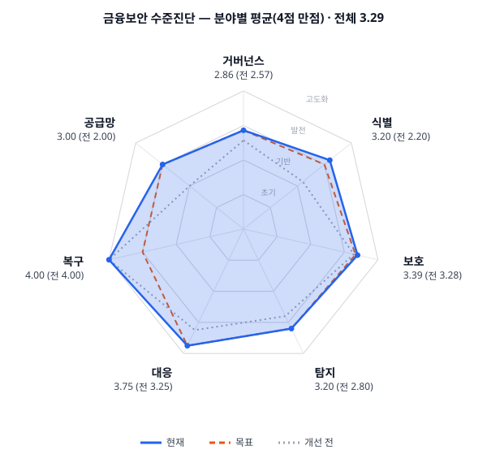

# 금융보안 수준진단 자가진단 — OUTOFSTOCK

> 생성: `python run.py assurance-docs` — 카탈로그(`app/security/ssf_catalog.json`)·코드·시험이 바뀌면 다시 만든다(`tests/test_assessment.py` 가 문서와 코드의 차이를 잡는다).
> 기준: 금융보안원 「금융보안 수준진단 프레임워크(Self-regulated Security Framework)」 v1.0 (2026.2) — 7개 분야 · 45개 항목 · 127개 세부원칙 · 성숙도 4단계(초기·기반·발전·고도화) · NIST CSF 2.0(2024.2 — 6개 기능 106개 하위 항목) 매핑.
> 등급은 근거 '종류'로 자동 판정한 **자체 기준**이다(세부원칙·구현기준 비공개) — 금융회사 진단 결과와 직접 비교하지 않는다.
> 이 문서의 등급은 정적 판정(설계·구현 근거)이고, 운영 서버의 점검(프로브) 결과까지 반영한 판정은 `/admin/assessment`.

## 1. 경영진 보고 요약

| 구분 | 내용 |
|---|---|
| 범위 | 서비스 1개: API·웹 화면·DB·배치·실시간 수집기·배포 스크립트. 조직 거버넌스(이사회·예산·인사)는 범위 밖 |
| 조직 중요도 | CRI 프로파일 중요도 Tier 4(국소적 영향) — 이용자 100만 명 미만, 다른 기관의 업무 연속성과 무관 |
| 전체 성숙도 | **현재 3.29** / 목표 3.21 (개선 전 2.93) — 4점 만점 |
| 등급 분포 | 초기 0 · 기반 3 · 발전 24 · 고도화 15 (범위 안 42개 · 제외 3개) |
| 목표 미달 | 0개 항목 |
| NIST CSF 2.0 | 근거가 있는 하위 항목 **80/106** (개선 전 67) |

| 분야 | 범위 안 항목 | 개선 전 | 현재 | 목표 | 가중치 |
|---|---:|---:|---:|---:|---:|
| 1. 거버넌스 | 7/8 | 2.57 | **2.86** | 2.86 | 1.0 |
| 2. 식별 | 5/5 | 2.20 | **3.20** | 3.00 | 1.0 |
| 3. 보호 | 18/20 | 3.28 | **3.39** | 3.33 | 1.5 |
| 4. 탐지 | 5/5 | 2.80 | **3.20** | 3.20 | 1.2 |
| 5. 대응 | 4/4 | 3.25 | **3.75** | 3.75 | 1.5 |
| 6. 복구 | 1/1 | 4.00 | **4.00** | 3.00 | 1.2 |
| 7. 공급망 | 2/2 | 2.00 | **3.00** | 3.00 | 1.0 |

### 진단 → 개선 → 재평가: 이번에 오른 항목

| 항목 | 개선 전 | 현재 | 무엇을 했나 |
|---|---|---|---|
| 1.1 사이버보안 전략 수립 및 개선 | 기반(2) | **발전(3)** | 진단 → 개선 → 재평가 주기를 코드로(매월 재진단·퇴보 경보·기준선 비교) |
| 1.2 경영진 참여 보장 | 초기(1) | **기반(2)** | 경영진 보고 요약 자동 생성 + 분기 보고 절차(내부 관리계획 §17) |
| 2.1 자산 식별 및 관리 | 기반(2) | **발전(3)** | 자산 목록 자동 생성(5종) + 운영 DB 표 ↔ 분류 등록부 차이 점검 |
| 2.3 자산의 생명주기에 따른 보안 관리 | 발전(3) | **고도화(4)** |  |
| 2.4 위험 평가 | 기반(2) | **발전(3)** | 위협마다 가능성×영향(고유·잔여) 점수 + '확인' 열 시험 실재 검사 |
| 2.5 위험 처리 | 초기(1) | **발전(3)** | 위험 등록부(처리·담당·재검토) + 위험 성향 초과 시 계획·승인 강제 |
| 3.14 시스템 설정 관리 | 발전(3) | **고도화(4)** | 변경관리 배포 게이트 — 깨진 설치본은 서비스를 멈추기 전에 차단·승인은 다른 사람만(훈련 실측) |
| 3.15 비인가 소프트웨어 설치 및 실행 방지 | 기반(2) | **발전(3)** | 배포 기준선 대비 새 파일(웹셸)·변경 감시 |
| 4.4 소프트웨어 및 시스템 파일 모니터링 | 초기(1) | **발전(3)** | 파일 무결성 감시(FIM) — 웹셸·승인 안 된 변경 탐지 |
| 5.2 보안사고 분석·관리 | 발전(3) | **고도화(4)** | 장애·침해 사건 판정·보고서 초안·보고 기한 알림 — 장애 판정·보고 훈련 실측 |
| 5.3 보안사고 조치 | 발전(3) | **고도화(4)** | 사고 대응 모의훈련 5개 시나리오 — 탐지 → 차단 → 복구 실측 |
| 7.1 공급사 선정기준 및 계약 요건 정의 | 초기(1) | **발전(3)** | 선정 기준·이용 요건(S1~S8) + 행마다 기준 칸 시험 |

### 남은 갭(우선순위 = 갭 × 분야 가중치 — 금융은 보호·대응을 무겁게)

이번 주기 목표 미달 없음. 다음 주기에 목표를 올릴 후보(목표 프로파일 갱신 — CSF 프로파일 5단계 '이행 및 갱신'):

| 항목 | 현재 | 다음 단계 |
|---|---|---|
| 1.7 정보보호 교육 및 훈련 | 기반(2) | 보안 교육 기록(누가·언제·무엇)과 연 1회 이상 이수 확인 |
| 3.1 사용자 인증 | 고도화(4) | 일반 이용자 2단계 인증은 선택 — 피싱 저항 로그인(패스키) |
| 3.6 암호화 및 키 관리 | 발전(3) | KEK 를 KMS/HSM 또는 비밀 관리자로(지금은 환경변수) |
| 3.10 자산 보안패치 관리 | 발전(3) | 의존성 갱신 자동화(봇 PR)와 조치 기한(SLA) 관리 |
| 3.20 오픈소스 관리 | 발전(3) | 라이선스 점검 · SBOM 서명 |
| 4.4 소프트웨어 및 시스템 파일 모니터링 | 발전(3) | 실시간 감시(inotify)·기준선 서명(외부 키) |
| 5.4 사고대응·복구 훈련 수행 | 발전(3) | 훈련 일정 자동화(분기 스케줄)와 사람 참여 훈련(도상 훈련) 기록 |

### 범위 상한·제외(결정이 필요한 것)

| 항목 | 상한 | 이유 |
|---|---|---|
| 1.1 사이버보안 전략 수립 및 개선 | 발전(3) | 조직 전략·경영진 승인은 학생 프로젝트 범위 밖 |
| 1.2 경영진 참여 보장 | 기반(2) | 이사회·경영진이 없는 학생 팀 — 팀장·지도교수 보고로 대체 |
| 1.7 정보보호 교육 및 훈련 | 기반(2) | 교육 이수를 관리할 조직이 없다 — 팀 개발 가이드와 자동 경고로 대체 |
| 3.9 악성코드 차단 | 기반(2) | 서버 백신·EDR 은 운영 환경 몫 — 이 서비스에는 파일 업로드 기능이 없다 |
| 3.18 단말기 보안 | 발전(3) | 이용자 단말의 보안 상태(MDM·EDR)는 관리 대상이 아니다 |
| 4.1 네트워크 환경 모니터링 | 발전(3) | 네트워크 IDS·NDR 은 범위 밖 — 앱·프록시 계층에서 감시 |
| 1.5 정보보호 자원(인력 및 예산) 확보 | 제외 | 학생 팀 — 인력·예산을 배정할 조직 주체가 없다(범위 밖) |
| 3.3 물리적 접근통제 | 제외 | 자체 전산실이 없다 — 클라우드·학교 VM 제공자 책임 |
| 3.16 무선 네트워크 보호 | 제외 | 무선망 자산이 없다(클라우드·VM 서비스) |

## 2. 판정 규칙(자체 기준)

| 등급 | 조건(앞 단계 포함) | 뜻 |
|---|---|---|
| 초기(1) Initial | 기준(문서)과 이행 근거가 함께 있지 않다 | 비체계적·임시 |
| 기반(2) Defined | 문서 + 구현·시험·이행 기록 중 하나 | 정해져 있고 만들어져 있다 |
| 발전(3) Managed | + 자동 시험 + 운영 점검(프로브) 또는 자동 대응 | 깨지면 안다 |
| 고도화(4) Advanced | + 자동 대응 + 실측·훈련 기록 | 깨지면 스스로 막고, 효과를 숫자로 안다 |

- 근거는 기계가 확인한다: 파일·함수·시험 이름이 실제로 있는지(파이썬은 구문 트리), 탐지 규칙·스케줄 작업이 등록돼 있는지. 근거가 사라지면 등급이 내려가고, 시험이 실패한다(증빙 무결성).
- 운영 모드에서는 프로브(감사 체인·원장·RLS·정책·설정 기준선·암호화·백업·훈련·부하·파일 무결성 등)를 실제로 돌려, 실패한 항목을 기반(2)으로 내린다.
- 사람이 정하는 것: 어떤 근거를 어느 항목에 거는가 · 범위 상한(cap) · 목표 — 모두 카탈로그에 이유와 함께.

## 3. 45개 항목

| ID | 항목 | CSF 2.0 | 개선 전 | 현재 | 목표 | 근거 종류 | 메모 |
|---|---|---|---|---|---|---|---|
| 1.1 | 사이버보안 전략 수립 및 개선 | GV.OC-01, GV.RM-01, ID.IM-01, ID.IM-03 | 기반(2) | **발전(3)** (상한 3) | 발전(3) | 문서 구현 자동 시험 자동 대응 실측·훈련 기록 | 수준진단 엔진 — 근거 기계 확인, 매월 재진단·등급 퇴보 경보, 결과는 감사 체인에 고정. 개선 전 기준선을 같은 엔진으로 재 두었다 |
| 1.2 | 경영진 참여 보장 | GV.RR-01, GV.OV-01, GV.OV-02 | 초기(1) | **기반(2)** (상한 2) | 기반(2) | 문서 구현 | 진단 결과를 한 장 요약(분야별 현재·목표·개선 전, 남은 갭, 결정이 필요한 상한)으로 자동 생성 — 분기 보고 절차 |
| 1.3 | 법적 규제 및 요구사항 준수 | GV.OC-03 | 발전(3) | **발전(3)** | 발전(3) | 문서 구현 자동 시험 운영 점검 | 규정 대응표(안전성 확보조치·전자금융감독규정·시행세칙 사고보고·N²SF·BCBS 239) + 기준선 점검 도구가 CI 에서 돈다 · 보고 대상 판정·기한(시행세칙 제7조의4)을 코드로 |
| 1.4 | 역할 및 책임의 명확화 | GV.RR-02 | 발전(3) | **발전(3)** | 발전(3) | 문서 구현 자동 시험 운영 점검 | 관리 역할 3종(감사·보안·관리)과 동작별 허용 역할이 정책 파일에 — 직무 분리(2인 승인) 시험 |
| 1.5 | 정보보호 자원(인력 및 예산) 확보 | GV.RR-03 | 제외 | 제외 | — | — | 학생 팀 — 인력·예산을 배정할 조직 주체가 없다(범위 밖) |
| 1.6 | 보안 정책 수립 및 관리 | GV.PO-01, GV.PO-02 | 고도화(4) | **고도화(4)** | 고도화(4) | 문서 구현 자동 시험 운영 점검 자동 대응 실측·훈련 기록 | 정책을 코드와 분리한 파일(버전·해시) — 모든 경로가 정책 동작을 선언해야 하고, 형식이 틀리면 기동 거부(fail closed) |
| 1.7 | 정보보호 교육 및 훈련 | PR.AT-01, PR.AT-02 | 기반(2) | **기반(2)** (상한 2) | 기반(2) | 문서 구현 | 화면 팀용 보안 규칙(외부 스크립트·인라인 핸들러 금지)을 가이드로 두고 반영 도구가 미리 경고 |
| 1.8 | 정보 노출 방지 및 업무 환경 보안 | PR.DS-01, PR.DS-02, PR.DS-10 | 발전(3) | **발전(3)** | 발전(3) | 문서 구현 자동 시험 자동 대응 | 자유 입력의 주민번호·카드번호를 저장 전 가림 + 로그·알림 출구 가림(redact) |
| 2.1 | 자산 식별 및 관리 | ID.AM-01, ID.AM-02, ID.AM-03, ID.AM-04, ID.AM-07 | 기반(2) | **발전(3)** | 발전(3) | 문서 구현 자동 시험 운영 점검 | 자산 5종(데이터·업무 서비스·외부 연동·소프트웨어·구성요소)을 코드에서 한 목록으로 — 운영 DB 에 분류 안 된 표가 생기면 점검 실패 |
| 2.2 | 자산 중요도 평가 | ID.AM-05, GV.OC-04 | 발전(3) | **발전(3)** | 발전(3) | 문서 구현 자동 시험 자동 대응 | 데이터·구성요소는 기밀성+무결성+가용성(각 1~3) → 1~3등급, 업무 동작은 critical·normal·low — 업무 중요도는 과부하 때 자동 보호 순서 |
| 2.3 | 자산의 생명주기에 따른 보안 관리 | ID.AM-08 | 발전(3) | **고도화(4)** | 발전(3) | 문서 구현 자동 시험 운영 점검 자동 대응 실측·훈련 기록 | 보관 기간 파기(매일)·탈퇴 즉시 삭제·관리 자격 90일 만료 + 60일 안 쓴 자격 자동 회수·기능 폐기 시 표 삭제 · 데이터 수명주기(뉴스·검색 13개월 → 압축 보관·SHA-256 검증 후 정리·복원, 보관 기록은 앱이 고칠 수 없음) |
| 2.4 | 위험 평가 | ID.RA-03, ID.RA-04, ID.RA-05 | 기반(2) | **발전(3)** | 발전(3) | 문서 구현 자동 시험 운영 점검 실측·훈련 기록 | 위협 35개(STRIDE)마다 가능성×영향 — 고유·잔여, 히트맵. 위협 모델 '확인' 열의 시험이 실제로 있는지 구문 트리로 검사 |
| 2.5 | 위험 처리 | ID.RA-06, ID.RA-07, GV.RM-04 | 초기(1) | **발전(3)** | 발전(3) | 문서 구현 자동 시험 운영 점검 | 처리(감소·수용·전가·회피)·담당·재검토일(180일) — 위험 성향 9 를 넘는 잔여는 계획+기한 또는 승인 수용이 있어야 시험 통과 |
| 3.1 | 사용자 인증 | PR.AA-01, PR.AA-02, PR.AA-03, PR.AA-04 | 고도화(4) | **고도화(4)** | 고도화(4) | 문서 구현 자동 시험 자동 대응 실측·훈련 기록 | 세션 매 요청 재검증·갱신 토큰 회전·TOTP·기기 결속 키(DPoP) — 탈취 신호는 자동 세션 종료 |
| 3.2 | 사용자 권한 관리 | PR.AA-05 | 고도화(4) | **고도화(4)** | 고도화(4) | 문서 구현 자동 시험 운영 점검 자동 대응 실측·훈련 기록 | 상시 관리자 없음(JIT 30분·자동 만료) · 자격은 2인 승인 · 60일 안 쓴 자격 자동 회수 · 인사조치 일괄 회수 · 개인 데이터는 DB FORCE RLS |
| 3.3 | 물리적 접근통제 | PR.AA-06, DE.CM-02 | 제외 | 제외 | — | — | 자체 전산실이 없다 — 클라우드·학교 VM 제공자 책임 |
| 3.4 | 저장 데이터 보호 | PR.DS-01 | 발전(3) | **발전(3)** | 발전(3) | 문서 구현 자동 시험 운영 점검 | L4 는 해시·봉투 암호화만(시험이 강제) · 돈 데이터는 복식부기·일 마감 해시 사슬로 무결성 |
| 3.5 | 전송 데이터 보호 | PR.DS-02 | 발전(3) | **발전(3)** | 발전(3) | 문서 구현 자동 시험 운영 점검 | 경계 TLS 1.2/1.3 · DB 평문 TCP 거부(선택) · 백업 age 암호화 |
| 3.6 | 암호화 및 키 관리 | PR.DS-01, PR.DS-02 | 발전(3) | **발전(3)** | 발전(3) | 문서 구현 자동 시험 운영 점검 실측·훈련 기록 | HKDF 용도별 하위 키 · 키 ID 다중 키 링 · 재포장 교체 · 복구 훈련이 키 링 점검 |
| 3.7 | 백업 데이터 보호 | PR.DS-11 | 고도화(4) | **고도화(4)** | 고도화(4) | 문서 구현 자동 시험 운영 점검 자동 대응 실측·훈련 기록 | 매일 age 암호화 백업 + 원격 사본 · manifest 로 변조 탐지 · 실패·지연은 자동 경보 · 훈련 실측 RTO |
| 3.8 | 로그 관리 | PR.PS-04 | 고도화(4) | **고도화(4)** | 고도화(4) | 문서 구현 자동 시험 운영 점검 자동 대응 실측·훈련 기록 | 감사 해시 체인 + 매일 외부 증인 · 앱 계정은 감사 기록 수정·삭제 불가 · 보관 기간은 달력 기준 하한 · 외부 관제 연동(CEF·JSON Lines — 아이디 가명, 내보내기도 감사 기록) |
| 3.9 | 악성코드 차단 | DE.CM-09, PR.PS-05 | 기반(2) | **기반(2)** (상한 2) | 기반(2) | 문서 구현 | 업로드 기능 없음 · 의존성 취약점·정적 분석 주 1회 |
| 3.10 | 자산 보안패치 관리 | PR.PS-02, ID.RA-01 | 발전(3) | **발전(3)** | 발전(3) | 문서 구현 자동 시험 자동 대응 | 서버 자동 보안 업데이트 · 매주 취약점 점검(CI 예약 실행) · 해시 고정 잠금 파일 |
| 3.11 | 안전한 소프트웨어개발 생명주기 정의·설계 | PR.PS-06 | 발전(3) | **발전(3)** | 발전(3) | 문서 구현 자동 시험 자동 대응 | 설계 규칙을 시험으로 — 새 경로는 정책 동작, 새 표는 분류부터(빠지면 CI 실패) |
| 3.12 | 안전한 소프트웨어개발 생명주기 개발·테스트 | PR.PS-06, ID.IM-02 | 고도화(4) | **고도화(4)** | 고도화(4) | 문서 구현 자동 시험 운영 점검 자동 대응 실측·훈련 기록 | 커밋마다 시험(KST·UTC)·최소 권한 시험·정적 분석·실제 브라우저 E2E · 독립 점검 실측 · 취약점 자가 점검(침투테스트 가이드라인 4단계·ATT&CK 22개 점검) — 첫 실행에서 공용 데모 세션 IDOR 발견·수정 |
| 3.13 | 네트워크 분리 및 접근통제 | PR.IR-01 | 고도화(4) | **고도화(4)** | 발전(3) | 문서 구현 자동 시험 자동 대응 실측·훈련 기록 | 망 4개 분리 · 나가는 연결 3중(앱 허용 목록 → 프록시 → 커널) · 실측 N-4 |
| 3.14 | 시스템 설정 관리 | PR.PS-01 | 발전(3) | **고도화(4)** | 고도화(4) | 문서 구현 자동 시험 운영 점검 자동 대응 실측·훈련 기록 | 설정 기준선(근거 조항 포함) + 변경관리 배포 게이트 — 사전 영향 분석·자동 점검(구문·적용된 마이그레이션·정책)·요청자 ≠ 승인자·배포 금지 시간·긴급 변경 3일 사후 검토, 변경 기록은 앱이 지우거나 해시를 못 바꾼다 |
| 3.15 | 비인가 소프트웨어 설치 및 실행 방지 | PR.PS-05 | 기반(2) | **발전(3)** | 발전(3) | 문서 구현 자동 시험 운영 점검 자동 대응 | 해시 고정 설치·읽기 전용 컨테이너·코드 읽기 전용 샌드박스 + 배포 기준선 밖의 새 파일·변경을 10분마다 탐지 |
| 3.16 | 무선 네트워크 보호 | PR.IR-01 | 제외 | 제외 | — | — | 무선망 자산이 없다(클라우드·VM 서비스) |
| 3.17 | 원격 접속 보안 관리 | PR.AA-03, PR.IR-01 | 발전(3) | **발전(3)** | 발전(3) | 문서 구현 자동 시험 자동 대응 | SSH 키·관리자 대역·root 원격 금지·시도 제한 · 관리 화면은 기기 인증서(선택) + TOTP + JIT |
| 3.18 | 단말기 보안 | PR.AA-03, DE.CM-09 | 발전(3) | **발전(3)** (상한 3) | 발전(3) | 문서 구현 자동 시험 자동 대응 | 세션을 브라우저의 꺼낼 수 없는 키에 결속 — 쿠키를 다른 기기로 옮기면 실패·세션 종료 |
| 3.19 | 가용성 유지를 위한 복원력 확보 | PR.IR-03, PR.IR-04 | 고도화(4) | **고도화(4)** | 고도화(4) | 문서 구현 자동 시험 운영 점검 자동 대응 실측·훈련 기록 | 용량 4단계 · 우선순위 대량접속제어 · 풀 빠른 실패 · 과부하 실측(핵심 거래 p95 899 → 354ms) · 1분 합성 모니터링·30일 가용률(목표 99.5%)·감시 범위 · DB 용량 관리(일일 크기·디스크 소진 예측·비대화·XID 경보, 1년 규모 1,182 → 807MB, 서버 설정 자동 적용) |
| 3.20 | 오픈소스 관리 | ID.RA-09, PR.PS-02 | 발전(3) | **발전(3)** | 발전(3) | 문서 구현 자동 시험 자동 대응 | 해시 고정 잠금 파일 · SBOM(CycloneDX) · 주 1회 취약점 점검 |
| 4.1 | 네트워크 환경 모니터링 | DE.CM-01 | 발전(3) | **발전(3)** (상한 3) | 발전(3) | 문서 구현 자동 시험 운영 점검 자동 대응 | 막힌 외부 연결 기록 · 요청량·지연·부하 단계 지표 · IP 단위 대입 공격 자동 차단 |
| 4.2 | 내부자 활동 모니터링 | DE.CM-03 | 발전(3) | **발전(3)** | 발전(3) | 문서 구현 자동 시험 운영 점검 자동 대응 | 관리자 개인정보 열람은 목적 필수·기록 · 월 점검 리포트(야간·대량·반복) · 하루 50명↑ 자동 경보 |
| 4.3 | 외부 연결구간 모니터링 | DE.CM-06, DE.CM-01 | 발전(3) | **발전(3)** | 발전(3) | 문서 구현 자동 시험 자동 대응 | 원천별 서킷 브레이커 상태 · 허용 목록 밖 연결 기록 · 적재 품질 게이트 |
| 4.4 | 소프트웨어 및 시스템 파일 모니터링 | DE.CM-09 | 초기(1) | **발전(3)** | 발전(3) | 문서 구현 자동 시험 운영 점검 자동 대응 | 배포 직후 기준선(파일별 SHA-256 — 소유자 계정만 기록) 대비 10분마다 변경·삭제·새 파일 → 심각 이벤트·경보, 기준선 행 변조도 위반 |
| 4.5 | 탐지된 이벤트 분석 및 사고 판단 | DE.AE-02, DE.AE-03, DE.AE-04, DE.AE-08, DE.AE-06 | 고도화(4) | **고도화(4)** | 고도화(4) | 문서 구현 자동 시험 자동 대응 실측·훈련 기록 | 탐지 규칙(같은 주체의 짧은 반복 기준)·자동 대응 · FDS 10개 규칙 — 합성 평가로 탐지율·오탐률 실측 · 장애 자동 판정(10분)·보고 대상(30분 — 시행세칙 제7조의4)·중대 IT 장애 5개 지표 |
| 5.1 | 사고대응대책 운영 | RS.MA-01, RS.MA-02, RS.MA-03, ID.IM-04 | 고도화(4) | **고도화(4)** | 고도화(4) | 문서 구현 자동 시험 운영 점검 자동 대응 실측·훈련 기록 | 사고 대응 절차 · 기능별 비상 차단(멈춤 1인·재개 2인) · 실제 사고 사후 보고서 1건 · 경보 확인(ack)·15분 미확인 상향·MTTA |
| 5.2 | 보안사고 분석·관리 | RS.AN-03, RS.AN-06, RS.AN-07, RS.AN-08, DE.AE-07, RS.CO-03, RC.CO-03 | 발전(3) | **고도화(4)** | 고도화(4) | 문서 구현 자동 시험 운영 점검 자동 대응 실측·훈련 기록 | 요청 ID 로 응답·보안 이벤트·감사 기록을 잇는다 · 증거(감사 체인) 무결성 점검 · 장애·침해 사건 기록 → 보고서 초안(별지 제2호 12개 항목, 사건 전 변경 = 변경시점 후보 자동 첨부) · 최초 보고 기한 알림 |
| 5.3 | 보안사고 조치 | RS.MI-01, RS.MI-02, RS.MA-04, RS.CO-02 | 발전(3) | **고도화(4)** | 고도화(4) | 문서 구현 자동 시험 자동 대응 실측·훈련 기록 | 세션 종료·계정 잠금·IP 차단·기능 자동 중지(되돌릴 수 있는 조치만 자동) — 모의훈련으로 차단까지 걸린 시간을 실측 |
| 5.4 | 사고대응·복구 훈련 수행 | ID.IM-02, ID.IM-04 | 발전(3) | **발전(3)** | 발전(3) | 문서 구현 자동 시험 운영 점검 실측·훈련 기록 | 복구 훈련(분기, 실측 RTO ≤ 목표 3시간) + 사고 대응 모의훈련 7개 시나리오(격리 DB, 신호 → 탐지 → 차단 → 복구 — 장애 판정·보고, 깨진 배포 차단 포함, 단계별 시간 기록) |
| 6.1 | 복구 시 보안요건 반영 | RC.RP-01, RC.RP-03, RC.RP-05 | 고도화(4) | **고도화(4)** | 발전(3) | 문서 구현 자동 시험 운영 점검 자동 대응 실측·훈련 기록 | 복원 전 manifest·암호문 검증 → 새 DB 에 복원 → 체인·키 링·행 수 확인 통과 시에만 교체 · 실측 RTO 가 목표(감독규정 제23조 3시간)를 넘으면 점검 실패 |
| 7.1 | 공급사 선정기준 및 계약 요건 정의 | GV.SC-05, GV.SC-06, ID.RA-10 | 초기(1) | **발전(3)** | 발전(3) | 문서 구현 자동 시험 운영 점검 | 선정 기준·이용 요건 S1~S8 — 데이터 최소화·중요도·대체·빠져나오기는 등록부 행마다 채워야 시험 통과 |
| 7.2 | 공급사 현황 관리 | GV.SC-04, GV.SC-07, GV.SC-10 | 발전(3) | **발전(3)** | 발전(3) | 문서 구현 자동 시험 운영 점검 자동 대응 | 허용 목록(코드) ↔ 등록부 호스트 표가 한 줄도 어긋나지 않게(시험·운영 점검) · 원천 장애는 서킷 브레이커 |

## 4. NIST CSF 2.0 프로파일(현재)

CSF 프로파일 작성 단계(범위 정의 → 정보 수집 → 프로파일 작성 → 갭 분석 → 이행·갱신)를 이 진단이 그대로 따른다 — 범위는 §1, 현재 프로파일은 아래, 목표 프로파일은 항목별 목표, 갭은 §1 의 남은 갭.

| 기능 | 연결 항목 | 평균 성숙도 | 근거 있는 하위 항목 |
|---|---:|---:|---:|
| GV 거버넌스 | 9 | 3.00 | 16/31 |
| ID 식별 | 12 | 3.25 | 19/21 |
| PR 보호 | 20 | 3.30 | 19/22 |
| DE 탐지 | 8 | 3.12 | 10/11 |
| RS 대응 | 3 | 4.00 | 12/13 |
| RC 복구 | 2 | 4.00 | 4/8 |

근거가 아직 없는 하위 항목(범주별): GV.OC(조직 맥락) 02, 05 · GV.RM(위험관리 전략) 02, 03, 05, 06, 07 · GV.RR(역할·책임·권한) 03, 04 · GV.OV(감독) 03 · GV.SC(공급망 위험관리) 01, 02, 03, 08, 09 · ID.RA(위험 평가) 02, 08 · PR.AA(신원·인증·접근통제) 06 · PR.PS(플랫폼 보안) 03 · PR.IR(기술 인프라 복원력) 02 · DE.CM(지속 모니터링) 02 · RS.MA(사고 관리) 05 · RC.RP(복구 계획 실행) 02, 04, 06 · RC.CO(복구 소통) 04.

## 5. 항목별 근거

1.1 사이버보안 전략 수립 및 개선 — 발전(3)

- ✓ 문서 `docs/adr/README.md`
- ✓ 문서 `docs/security/zero_trust.md### 4. 남은 위험과 정직한 한계`
- ✓ 실측·훈련 기록 `docs/security/verification_report_2026-10-21.md`
- ✓ 구현 `app/security/assessment.py::run`
- ✓ 자동 시험 `tests/test_assessment.py::test_baseline_catalog_still_reproduces_the_baseline`
- ✓ 자동 대응 `job:assessment`
- ✓ 실측·훈련 기록 `docs/security/assessment/2026-11-02_baseline.json`
- 범위 상한 발전(3): 조직 전략·경영진 승인은 학생 프로젝트 범위 밖

1.2 경영진 참여 보장 — 기반(2)

- ✓ 문서 `docs/security/internal_management_plan.md### 15. 계획의 수립·변경·승인`
- ✓ 구현 `app/security/assessment.py::executive_summary`
- ✓ 문서 `docs/security/internal_management_plan.md### 17. 보안 수준 자가진단`
- 범위 상한 기반(2): 이사회·경영진이 없는 학생 팀 — 팀장·지도교수 보고로 대체

1.3 법적 규제 및 요구사항 준수 — 발전(3)

- ✓ 문서 `docs/security/compliance_mapping.md`
- ✓ 구현 `tools/security_check.py::checks`
- ✓ 자동 시험 `tests/test_deploy_config.py::test_prod_env_example_passes_the_security_baseline_and_holds_no_secrets`
- ✓ 자동 시험 `tests/test_infosec.py::test_legal_minimum_retention_counts_calendar_years_not_days`
- ✓ 운영 점검 `security_baseline`
- ✓ 자동 시험 `tests/test_incidents.py::test_reporting_rule_follows_enforcement_detail_7_4`
- ✓ 운영 점검 `incident_reports`

1.4 역할 및 책임의 명확화 — 발전(3)

- ✓ 문서 `docs/security/internal_management_plan.md### 1. 개인정보 보호 조직`
- ✓ 구현 `app/security/rbac.py::ROLES`
- ✓ 구현 `app/security/policy.json`
- ✓ 자동 시험 `tests/test_zero_trust.py::test_pdp_decision_matrix`
- ✓ 자동 시험 `tests/test_zero_trust.py::test_role_grant_needs_two_different_admins`
- ✓ 운영 점검 `policy`

1.6 보안 정책 수립 및 관리 — 고도화(4)

- ✓ 문서 `docs/adr/0012-policy-decision-and-jit-admin.md`
- ✓ 구현 `app/security/policy.json`
- ✓ 구현 `app/security/pdp.py::_validate`
- ✓ 자동 시험 `tests/test_zero_trust.py::test_every_api_route_declares_a_known_policy_action`
- ✓ 자동 시험 `tests/test_zero_trust.py::test_policy_file_is_validated_fail_closed`
- ✓ 자동 시험 `tests/test_zero_trust.py::test_route_without_policy_is_denied_by_default`
- ✓ 운영 점검 `policy`
- ✓ 자동 대응 `code:app/security/pep.py::enforce`
- ✓ 실측·훈련 기록 `docs/security/verification_report_2026-10-21.md`

1.7 정보보호 교육 및 훈련 — 기반(2)

- ✓ 문서 `web/README.md`
- ✓ 구현 `tools/sync_web.py`
- 범위 상한 기반(2): 교육 이수를 관리할 조직이 없다 — 팀 개발 가이드와 자동 경고로 대체
- 다음 단계: 보안 교육 기록(누가·언제·무엇)과 연 1회 이상 이수 확인

1.8 정보 노출 방지 및 업무 환경 보안 — 발전(3)

- ✓ 문서 `docs/adr/0024-device-bound-sessions-and-dlp.md`
- ✓ 구현 `app/security/dlp.py::scan`
- ✓ 구현 `app/redact.py`
- ✓ 자동 시험 `tests/test_dlp.py::test_transfer_memo_and_chat_are_masked_before_storage`
- ✓ 자동 시험 `tests/test_security.py::test_api_keys_never_leak_to_logs_or_public_health`
- ✓ 자동 대응 `code:app/security/dlp.py::guard`

2.1 자산 식별 및 관리 — 발전(3)

- ✓ 문서 `docs/data/data_dictionary.md`
- ✓ 문서 `docs/security/third_party_register.md`
- ✓ 구현 `app/security/classification.py::REGISTRY`
- ✓ 자동 시험 `tests/test_data_protection.py::test_every_table_is_classified_and_protections_hold`
- ✓ 자동 시험 `tests/test_datadocs.py::test_every_table_is_documented`
- ✓ 구현 `app/security/assets.py::inventory`
- ✓ 자동 시험 `tests/test_risk_register.py::test_asset_inventory_covers_every_table_action_and_external_host`
- ✓ 운영 점검 `asset_drift`

2.2 자산 중요도 평가 — 발전(3)

- ✓ 문서 `docs/security/threat_model.md### 1. 자산`
- ✓ 구현 `app/security/classification.py::LEVELS`
- ✓ 구현 `app/security/policy.json`
- ✓ 자동 시험 `tests/test_capacity.py::test_every_route_has_a_tier_and_money_auth_admin_are_critical`
- ✓ 자동 대응 `code:app/services/capacity.py::admit`
- ✓ 구현 `app/security/assets.py::data_cia`
- ✓ 자동 시험 `tests/test_risk_register.py::test_criticality_follows_the_cia_rule`

2.3 자산의 생명주기에 따른 보안 관리 — 고도화(4)

- ✓ 문서 `docs/security/internal_management_plan.md### 16. 그 밖`
- ✓ 구현 `app/services/privacy.py::retention_purge`
- ✓ 구현 `app/security/rbac.py::decide`
- ✓ 자동 시험 `tests/test_infosec.py::test_purge_records_its_audit_even_when_a_step_fails`
- ✓ 자동 시험 `tests/test_infosec.py::test_account_deletion_keeps_role_history_but_pseudonymized`
- ✓ 자동 대응 `job:security`
- ✓ 구현 `app/security/rbac.py::sweep_dormant`
- ✓ 자동 시험 `tests/test_privilege_lifecycle.py::test_dormant_admin_eligibility_is_revoked_but_bootstrap_is_flagged`
- ✓ 문서 `docs/adr/0027-db-storage-and-lifecycle.md`
- ✓ 구현 `app/services/ilm.py::archive`
- ✓ 자동 시험 `tests/test_ilm.py::test_archive_verifies_then_deletes_and_restore_brings_rows_back`
- ✓ 자동 시험 `tests/test_ilm.py::test_tampered_or_foreign_archives_are_refused`
- ✓ 운영 점검 `archive_integrity`
- ✓ 자동 대응 `job:ilm`
- ✓ 실측·훈련 기록 `docs/perf/db_space_2026-11-03.md`

2.4 위험 평가 — 발전(3)

- ✓ 문서 `docs/security/threat_model.md`
- ✓ 실측·훈련 기록 `docs/security/verification_report_2026-10-21.md`
- ✓ 구현 `app/security/riskreg.py::evaluate`
- ✓ 자동 시험 `tests/test_risk_register.py::test_every_threat_is_scored_and_its_checks_exist`
- ✓ 운영 점검 `risk_register`

2.5 위험 처리 — 발전(3)

- ✓ 문서 `docs/security/threat_model.md### 4. 남은 위험의 처리`
- ✓ 구현 `app/security/risk_register.json`
- ✓ 자동 시험 `tests/test_risk_register.py::test_high_residual_risk_needs_a_plan_or_an_acceptance`
- ✓ 운영 점검 `risk_register`

3.1 사용자 인증 — 고도화(4)

- ✓ 문서 `docs/adr/0011-zero-trust-sessions.md`
- ✓ 구현 `app/security/sessions.py`
- ✓ 구현 `app/security/passwords.py`
- ✓ 구현 `app/security/totp.py`
- ✓ 구현 `app/security/dpop.py::verify`
- ✓ 자동 시험 `tests/test_zero_trust.py::test_totp_enrollment_login_replay_recovery_and_encryption`
- ✓ 자동 시험 `tests/test_zero_trust.py::test_access_expiry_refresh_rotation_grace_and_reuse_detection`
- ✓ 자동 시험 `tests/test_dpop.py::test_stolen_cookies_on_another_device_cannot_refresh_or_move_money`
- ✓ 자동 대응 `rule:refresh_reuse`
- ✓ 자동 대응 `rule:dpop_mismatch`
- ✓ 실측·훈련 기록 `docs/security/verification_report_2026-10-21.md`
- 다음 단계: 일반 이용자 2단계 인증은 선택 — 피싱 저항 로그인(패스키)

3.2 사용자 권한 관리 — 고도화(4)

- ✓ 문서 `docs/adr/0012-policy-decision-and-jit-admin.md`
- ✓ 문서 `docs/adr/0013-row-level-security.md`
- ✓ 구현 `app/security/rbac.py::activate`
- ✓ 구현 `app/security/rls.py`
- ✓ 자동 시험 `tests/test_zero_trust.py::test_jit_elevation_requires_eligibility_mfa_and_reason`
- ✓ 자동 시험 `tests/test_zero_trust.py::test_role_grant_needs_two_different_admins`
- ✓ 자동 시험 `tests/test_rls.py::test_buggy_authorization_code_still_cannot_leak_other_users_rows`
- ✓ 운영 점검 `rls_forced`
- ✓ 자동 대응 `code:app/security/sessions.py::_VERIFY_SQL`
- ✓ 실측·훈련 기록 `docs/security/verification_report_2026-10-21.md`
- ✓ 구현 `app/security/rbac.py::offboard`
- ✓ 자동 시험 `tests/test_privilege_lifecycle.py::test_offboarding_revokes_everything_in_one_step`
- ✓ 운영 점검 `dormant_roles`

3.4 저장 데이터 보호 — 발전(3)

- ✓ 문서 `docs/adr/0014-envelope-encryption-and-keys.md`
- ✓ 구현 `app/crypto.py::encrypt`
- ✓ 자동 시험 `tests/test_data_protection.py::test_chat_bodies_are_encrypted_at_rest_and_rotated`
- ✓ 자동 시험 `tests/test_data_protection.py::test_every_table_is_classified_and_protections_hold`
- ✓ 운영 점검 `encryption_at_rest`
- ✓ 운영 점검 `ledger`

3.5 전송 데이터 보호 — 발전(3)

- ✓ 문서 `docs/security/compliance_mapping.md#제7조(전송)`
- ✓ 구현 `deploy/nginx/compose-tls.conf`
- ✓ 구현 `deploy/sql/pg_hba_tls.conf`
- ✓ 자동 시험 `tests/test_deploy_config.py::test_tls_edges_require_modern_tls_and_device_certs_for_admin`
- ✓ 자동 시험 `tests/test_deploy_config.py::test_tls_pg_hba_rejects_plaintext_tcp_before_any_accept`
- ✓ 운영 점검 `security_baseline`

3.6 암호화 및 키 관리 — 발전(3)

- ✓ 문서 `docs/adr/0014-envelope-encryption-and-keys.md`
- ✓ 구현 `app/security/keys.py`
- ✓ 구현 `app/crypto.py::rotate_all`
- ✓ 자동 시험 `tests/test_infosec.py::test_aes_gcm_roundtrip_binding_and_rotation`
- ✓ 자동 시험 `tests/test_zero_trust.py::test_pepper_hash_and_master_key_rotation`
- ✓ 자동 시험 `tests/test_dr.py::test_key_ring_check_finds_values_locked_by_a_missing_key`
- ✓ 운영 점검 `encryption_at_rest`
- ✓ 실측·훈련 기록 `docs/dr/drills/drill-20261020T084147.md`
- 다음 단계: KEK 를 KMS/HSM 또는 비밀 관리자로(지금은 환경변수)

3.7 백업 데이터 보호 — 고도화(4)

- ✓ 문서 `docs/adr/0019-backup-restore-drills.md`
- ✓ 문서 `docs/dr/README.md`
- ✓ 구현 `tools/dr.py::backup`
- ✓ 자동 시험 `tests/test_dr.py::test_encrypted_backup_detects_tampering_and_wrong_keys`
- ✓ 자동 시험 `tests/test_dr.py::test_full_restore_drill_passes_and_catches_an_empty_backup`
- ✓ 자동 시험 `tests/test_dr.py::test_admin_health_tracks_backup_age_and_drills_but_public_health_hides_them`
- ✓ 운영 점검 `backup_recent`
- ✓ 자동 대응 `code:tools/dr.py::_record_backup`
- ✓ 실측·훈련 기록 `docs/dr/drills/drill-20261020T084147.md`

3.8 로그 관리 — 고도화(4)

- ✓ 문서 `docs/adr/0006-audit-chain-encryption-privacy.md`
- ✓ 구현 `app/services/audit.py::verify`
- ✓ 구현 `app/logging_conf.py`
- ✓ 자동 시험 `tests/test_infosec.py::test_audit_chain_detects_tampering`
- ✓ 자동 시험 `tests/test_infosec.py::test_legal_minimum_retention_counts_calendar_years_not_days`
- ✓ 자동 시험 `tests/test_logging.py::test_api_process_emits_app_info_logs_with_level_module_and_redaction`
- ✓ 운영 점검 `audit_chain`
- ✓ 자동 대응 `job:security`
- ✓ 실측·훈련 기록 `docs/security/verification_report_2026-10-21.md`
- ✓ 구현 `app/security/siem.py::to_cef`
- ✓ 자동 시험 `tests/test_siem.py::test_cef_export_pseudonymizes_users_and_escapes_fields`

3.9 악성코드 차단 — 기반(2)

- ✓ 문서 `docs/security/internal_management_plan.md### 9. 악성프로그램 등 방지`
- ✓ 구현 `tools/security_scan.sh`
- 범위 상한 기반(2): 서버 백신·EDR 은 운영 환경 몫 — 이 서비스에는 파일 업로드 기능이 없다

3.10 자산 보안패치 관리 — 발전(3)

- ✓ 문서 `docs/security/internal_management_plan.md### 10. 취약점 점검`
- ✓ 구현 `tools/security_scan.sh`
- ✓ 구현 `deploy/vm.sh#unattended-upgrades`
- ✓ 자동 시험 `tests/test_deploy_config.py::test_requirements_lock_matches_requirements`
- ✓ 자동 대응 `code:.github/workflows/ci.yml#schedule:`
- 다음 단계: 의존성 갱신 자동화(봇 PR)와 조치 기한(SLA) 관리

3.11 안전한 소프트웨어개발 생명주기 정의·설계 — 발전(3)

- ✓ 문서 `docs/security/threat_model.md`
- ✓ 문서 `docs/security/secure_coding_69.md`
- ✓ 구현 `.github/workflows/ci.yml`
- ✓ 자동 시험 `tests/test_zero_trust.py::test_every_api_route_declares_a_known_policy_action`
- ✓ 자동 시험 `tests/test_data_protection.py::test_every_table_is_classified_and_protections_hold`
- ✓ 자동 대응 `code:.github/workflows/ci.yml#pytest`

3.12 안전한 소프트웨어개발 생명주기 개발·테스트 — 고도화(4)

- ✓ 문서 `docs/verification.md`
- ✓ 문서 `docs/security/scan_report.md`
- ✓ 구현 `tools/security_scan.sh`
- ✓ 구현 `tools/e2e_web.py`
- ✓ 자동 시험 `tests/test_web_security.py::test_pages_have_no_inline_event_handlers_or_eval`
- ✓ 자동 시험 `tests/test_query_budget.py::test_money_writes_stay_within_budget`
- ✓ 자동 대응 `code:.github/workflows/ci.yml#security_scan.sh`
- ✓ 실측·훈련 기록 `docs/security/verification_report_2026-10-21.md`
- ✓ 실측·훈련 기록 `docs/perf/overload_test_2026-11-02.md`
- ✓ 구현 `app/security/pentest.py::run`
- ✓ 자동 시험 `tests/test_pentest.py::test_self_pentest_finds_no_open_path`
- ✓ 자동 시험 `tests/test_pentest.py::test_legacy_shared_demo_session_is_not_reachable_by_number`
- ✓ 운영 점검 `pentest_recent`
- ✓ 실측·훈련 기록 `docs/security/pentest/pentest-20261102T221702.md`

3.13 네트워크 분리 및 접근통제 — 고도화(4)

- ✓ 문서 `docs/adr/0020-segmented-least-privilege-runtime.md`
- ✓ 구현 `app/security/egress.py::ALLOWED`
- ✓ 구현 `deploy/egress-proxy/squid.conf`
- ✓ 구현 `docker-compose.prod.yml`
- ✓ 자동 시험 `tests/test_deploy_config.py::test_compose_prod_least_privilege_and_segmentation`
- ✓ 자동 시험 `tests/test_egress.py::test_unlisted_host_is_blocked_before_any_network_io`
- ✓ 자동 대응 `code:app/security/egress.py::check_host`
- ✓ 실측·훈련 기록 `docs/security/verification_report_2026-10-21.md`

3.14 시스템 설정 관리 — 고도화(4)

- ✓ 문서 `docs/security/README.md`
- ✓ 구현 `tools/security_check.py::checks`
- ✓ 자동 시험 `tests/test_deploy_config.py::test_prod_env_example_passes_the_security_baseline_and_holds_no_secrets`
- ✓ 자동 시험 `tests/test_deploy_config.py::test_template_check_catches_a_committed_secret`
- ✓ 운영 점검 `security_baseline`
- ✓ 문서 `docs/adr/0026-it-internal-control.md`
- ✓ 구현 `app/services/changes.py::gate`
- ✓ 자동 시험 `tests/test_changes.py::test_gate_blocks_broken_release_even_in_record_mode`
- ✓ 자동 시험 `tests/test_changes.py::test_approval_needs_a_second_person_and_evidence`
- ✓ 운영 점검 `change_control`
- ✓ 자동 대응 `code:deploy/vm.sh#change_gate`
- ✓ 실측·훈련 기록 `docs/incidents/drills/incident-drill-20261102T131424.md`

3.15 비인가 소프트웨어 설치 및 실행 방지 — 발전(3)

- ✓ 문서 `docs/adr/0020-segmented-least-privilege-runtime.md`
- ✓ 구현 `Dockerfile`
- ✓ 구현 `requirements.lock`
- ✓ 구현 `deploy/outofstock-api.service`
- ✓ 자동 시험 `tests/test_deploy_config.py::test_dockerfile_runs_unprivileged_with_hash_pinned_deps`
- ✓ 자동 시험 `tests/test_deploy_config.py::test_vm_units_are_sandboxed_and_egress_locked`
- ✓ 운영 점검 `integrity`
- ✓ 자동 대응 `rule:file_integrity`
- ✓ 자동 시험 `tests/test_integrity.py::test_changed_missing_and_new_files_are_detected_against_the_baseline`

3.17 원격 접속 보안 관리 — 발전(3)

- ✓ 문서 `docs/security/internal_management_plan.md### 6. 접근 통제`
- ✓ 구현 `deploy/vm.sh#PermitRootLogin`
- ✓ 구현 `deploy/pki/make-pki.sh`
- ✓ 자동 시험 `tests/test_zero_trust.py::test_admin_actions_need_management_device_certificate_when_required`
- ✓ 자동 시험 `tests/test_deploy_config.py::test_tls_edges_require_modern_tls_and_device_certs_for_admin`
- ✓ 자동 대응 `code:deploy/vm.sh#ufw_q limit`

3.18 단말기 보안 — 발전(3)

- ✓ 문서 `docs/adr/0024-device-bound-sessions-and-dlp.md`
- ✓ 구현 `app/security/dpop.py::verify`
- ✓ 구현 `web/assets/oos/runtime.js#dpopProof`
- ✓ 자동 시험 `tests/test_dpop.py::test_stolen_cookies_on_another_device_cannot_refresh_or_move_money`
- ✓ 자동 대응 `rule:dpop_mismatch`
- 범위 상한 발전(3): 이용자 단말의 보안 상태(MDM·EDR)는 관리 대상이 아니다

3.19 가용성 유지를 위한 복원력 확보 — 고도화(4)

- ✓ 문서 `docs/adr/0023-operational-resilience.md`
- ✓ 구현 `app/services/capacity.py::admit`
- ✓ 구현 `app/services/controls.py::pause`
- ✓ 자동 시험 `tests/test_capacity.py::test_alert_level_sheds_low_tier_first_and_keeps_core_transactions`
- ✓ 자동 시험 `tests/test_resilience.py::test_db_outage_returns_503_with_retry_after`
- ✓ 자동 시험 `tests/test_capacity.py::test_pool_exhaustion_fails_fast_with_503`
- ✓ 운영 점검 `capacity`
- ✓ 자동 대응 `code:app/services/capacity.py::admit`
- ✓ 실측·훈련 기록 `docs/perf/overload_test_2026-11-02.md`
- ✓ 실측·훈련 기록 `docs/perf/load_test_2026-10-20.md`
- ✓ 구현 `app/services/incidents.py::run_check`
- ✓ 자동 시험 `tests/test_incidents.py::test_availability_coverage_and_probe`
- ✓ 운영 점검 `uptime_slo`
- ✓ 자동 대응 `job:uptime`
- ✓ 구현 `app/services/dbhealth.py::forecast`
- ✓ 자동 시험 `tests/test_dbhealth.py::test_forecast_fits_the_growth_trend_and_days_to_full`
- ✓ 자동 시험 `tests/test_db_types.py::test_retype_converts_legacy_values_quarantines_broken_ones_and_reconciles`
- ✓ 운영 점검 `db_capacity`
- ✓ 자동 대응 `job:db_daily`
- ✓ 실측·훈련 기록 `docs/perf/db_space_2026-11-03.md`

3.20 오픈소스 관리 — 발전(3)

- ✓ 문서 `docs/security/third_party_register.md### 2. 소프트웨어 공급망`
- ✓ 구현 `tools/check_lock.py`
- ✓ 구현 `requirements.lock`
- ✓ 자동 시험 `tests/test_deploy_config.py::test_requirements_lock_matches_requirements`
- ✓ 자동 대응 `code:.github/workflows/ci.yml#cyclonedx`
- 다음 단계: 라이선스 점검 · SBOM 서명

4.1 네트워크 환경 모니터링 — 발전(3)

- ✓ 문서 `docs/security/zero_trust.md`
- ✓ 구현 `app/services/observability.py`
- ✓ 구현 `app/security/egress.py::_report`
- ✓ 자동 시험 `tests/test_egress.py::test_first_block_right_after_boot_is_recorded`
- ✓ 자동 시험 `tests/test_capacity.py::test_prometheus_exposes_capacity_gauges`
- ✓ 운영 점검 `capacity`
- ✓ 자동 대응 `rule:login_fail`
- 범위 상한 발전(3): 네트워크 IDS·NDR 은 범위 밖 — 앱·프록시 계층에서 감시

4.2 내부자 활동 모니터링 — 발전(3)

- ✓ 문서 `docs/security/internal_management_plan.md### 8. 접속기록 보관 및 점검`
- ✓ 구현 `app/services/privacy.py::access_review`
- ✓ 구현 `app/services/audit.py::record`
- ✓ 자동 시험 `tests/test_zero_trust.py::test_pii_view_needs_purpose_is_logged_and_reviewable`
- ✓ 운영 점검 `audit_chain`
- ✓ 자동 대응 `rule:pii_access`

4.3 외부 연결구간 모니터링 — 발전(3)

- ✓ 문서 `docs/security/third_party_register.md### 3. 통제`
- ✓ 구현 `app/security/egress.py::status`
- ✓ 자동 시험 `tests/test_egress.py::test_circuit_breaker_fails_fast_then_recovers`
- ✓ 자동 시험 `tests/test_egress.py::test_monitor_mode_records_without_blocking`
- ✓ 자동 대응 `code:app/security/egress.py::breaker`

4.4 소프트웨어 및 시스템 파일 모니터링 — 발전(3)

- ✓ 구현 `tools/make_installer.py::build`
- ✓ 자동 시험 `tests/test_deploy_scripts.py::test_update_rejects_files_that_are_not_our_installer`
- ✓ 문서 `docs/adr/0025-autonomous-security-assessment.md`
- ✓ 구현 `app/security/integrity.py::check`
- ✓ 자동 시험 `tests/test_integrity.py::test_changed_missing_and_new_files_are_detected_against_the_baseline`
- ✓ 자동 시험 `tests/test_integrity.py::test_tampered_baseline_row_is_itself_a_violation`
- ✓ 운영 점검 `integrity`
- ✓ 자동 대응 `rule:file_integrity`
- ✓ 자동 대응 `job:integrity`
- 다음 단계: 실시간 감시(inotify)·기준선 서명(외부 키)

4.5 탐지된 이벤트 분석 및 사고 판단 — 고도화(4)

- ✓ 문서 `docs/adr/0016-fds-rules-and-outbox.md`
- ✓ 구현 `app/security/events.py::RULES`
- ✓ 구현 `app/services/fds.py`
- ✓ 자동 시험 `tests/test_zero_trust.py::test_probing_other_peoples_sessions_auto_revokes_the_session`
- ✓ 자동 시험 `tests/test_fds.py::test_account_takeover_drain_is_blocked_and_recorded`
- ✓ 자동 대응 `rule:login_fail`
- ✓ 실측·훈련 기록 `docs/models/fds_eval.md`
- ✓ 구현 `app/services/incidents.py::evaluate`
- ✓ 자동 시험 `tests/test_incidents.py::test_outage_is_opened_marked_reportable_and_closed`
- ✓ 자동 대응 `job:uptime`

5.1 사고대응대책 운영 — 고도화(4)

- ✓ 문서 `docs/security/internal_management_plan.md### 12. 유출사고 대응`
- ✓ 문서 `docs/dr/README.md### 5. 사고별 대응`
- ✓ 구현 `app/services/controls.py::pause`
- ✓ 구현 `app/services/alerts.py::notify`
- ✓ 자동 시험 `tests/test_controls.py::test_admin_api_pause_and_two_person_resume`
- ✓ 자동 시험 `tests/test_incident_response.py::test_scheduler_job_failure_sends_alert`
- ✓ 자동 대응 `rule:ledger_tamper`
- ✓ 실측·훈련 기록 `docs/incidents/2026-10-10-krx-load-rollback.md`
- ✓ 구현 `app/services/alerts.py::escalate_unacked`
- ✓ 자동 시험 `tests/test_alerts_ops.py::test_unacked_error_alert_escalates_once_and_ack_clears_it`
- ✓ 운영 점검 `alerts_acked`
- ✓ 자동 대응 `job:watch`

5.2 보안사고 분석·관리 — 고도화(4)

- ✓ 문서 `docs/security/internal_management_plan.md### 12. 유출사고 대응`
- ✓ 구현 `app/security/context.py`
- ✓ 구현 `app/services/audit.py::record`
- ✓ 자동 시험 `tests/test_zero_trust.py::test_request_id_links_response_events_and_audit`
- ✓ 운영 점검 `audit_chain`
- ✓ 실측·훈련 기록 `docs/incidents/2026-10-10-krx-load-rollback.md`
- ✓ 문서 `docs/adr/0026-it-internal-control.md`
- ✓ 구현 `app/services/incidents.py::report_md`
- ✓ 자동 시험 `tests/test_incidents.py::test_security_incident_is_reportable_from_the_start_and_report_draft_has_all_fields`
- ✓ 자동 시험 `tests/test_incidents.py::test_report_deadline_reminders_warn_then_escalate_when_overdue`
- ✓ 운영 점검 `incident_reports`
- ✓ 자동 대응 `job:watch`
- ✓ 실측·훈련 기록 `docs/incidents/drills/incident-drill-20261102T131424.md`

5.3 보안사고 조치 — 고도화(4)

- ✓ 문서 `docs/adr/0023-operational-resilience.md`
- ✓ 구현 `app/services/controls.py::auto_pause`
- ✓ 구현 `app/security/events.py::lock_account`
- ✓ 자동 시험 `tests/test_controls.py::test_ledger_tamper_pauses_money_features_automatically`
- ✓ 자동 시험 `tests/test_zero_trust.py::test_credential_stuffing_from_one_ip_blocks_login_temporarily`
- ✓ 자동 대응 `rule:ledger_tamper`
- ✓ 자동 대응 `rule:login_fail`
- ✓ 실측·훈련 기록 `docs/incidents/drills/incident-drill-20261102T131424.md`

5.4 사고대응·복구 훈련 수행 — 발전(3)

- ✓ 문서 `docs/dr/README.md### 4. 정기 훈련`
- ✓ 구현 `tools/dr.py::drill`
- ✓ 자동 시험 `tests/test_dr.py::test_full_restore_drill_passes_and_catches_an_empty_backup`
- ✓ 운영 점검 `dr_drill_recent`
- ✓ 실측·훈련 기록 `docs/dr/drills/drill-20261020T084147.md`
- ✓ 구현 `app/security/drill.py::run`
- ✓ 자동 시험 `tests/test_incident_drill.py::test_drill_contains_and_recovers_every_scenario`
- ✓ 운영 점검 `drill_recent`
- ✓ 실측·훈련 기록 `docs/incidents/drills/incident-drill-20261102T131424.md`
- 다음 단계: 훈련 일정 자동화(분기 스케줄)와 사람 참여 훈련(도상 훈련) 기록

6.1 복구 시 보안요건 반영 — 고도화(4)

- ✓ 문서 `docs/dr/README.md`
- ✓ 구현 `tools/dr.py::verify`
- ✓ 자동 시험 `tests/test_dr.py::test_verify_process_cannot_fall_back_to_production_db_urls`
- ✓ 자동 시험 `tests/test_dr.py::test_encrypted_backup_detects_tampering_and_wrong_keys`
- ✓ 운영 점검 `dr_drill_recent`
- ✓ 자동 대응 `code:tools/dr.py::drill`
- ✓ 실측·훈련 기록 `docs/dr/drills/drill-20261020T084147.md`
- ✓ 자동 시험 `tests/test_incidents.py::test_dr_rto_over_target_fails_the_drill_probe`

7.1 공급사 선정기준 및 계약 요건 정의 — 발전(3)

- ✓ 문서 `docs/security/third_party_register.md`
- ✓ 문서 `docs/security/third_party_register.md## 0. 선정 기준`
- ✓ 구현 `app/security/assets.py::supplier_problems`
- ✓ 자동 시험 `tests/test_risk_register.py::test_every_supplier_row_answers_the_selection_criteria`
- ✓ 운영 점검 `egress_register`

7.2 공급사 현황 관리 — 발전(3)

- ✓ 문서 `docs/security/third_party_register.md### 1. 외부 데이터·서비스`
- ✓ 구현 `app/security/egress.py::ALLOWED`
- ✓ 자동 시험 `tests/test_egress.py::test_every_external_host_in_code_is_allowlisted`
- ✓ 자동 대응 `code:app/security/egress.py::breaker`
- ✓ 자동 시험 `tests/test_risk_register.py::test_allowlist_and_register_never_drift_apart`
- ✓ 운영 점검 `egress_register`

## 6. 한계

- 자체 판정 규칙은 '근거가 있는가'를 본다 — 통제가 충분히 강한지는 시험·실측 내용과 독립 점검이 판단한다.
- 범위가 서비스 1개다. 조직 거버넌스(경영진·예산·교육)는 상한을 두고 이유를 적었다.
- 금융보안원 진단은 자가진단 → 현장 실사(인터뷰·증빙 확인) → 결과 보고로 간다. 이 문서는 첫 단계(자가진단)에 해당하고, 현장 실사를 대신하는 것은 근거의 기계 확인과 감사 체인에 고정한 진단 이력이다.
